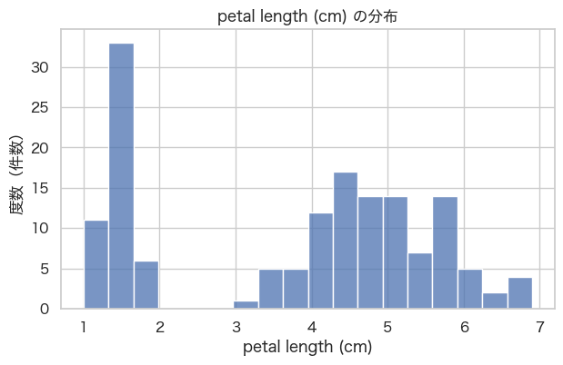
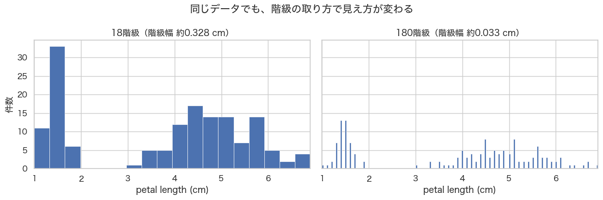
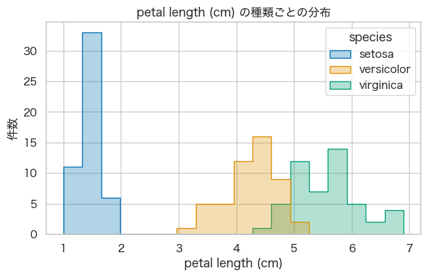
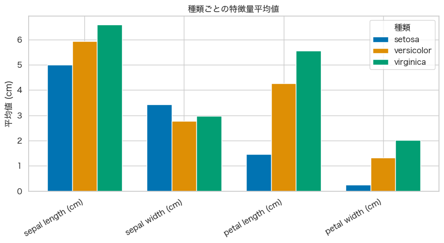
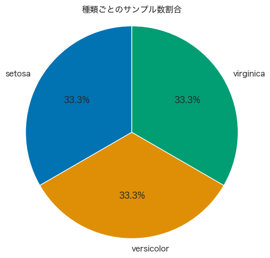
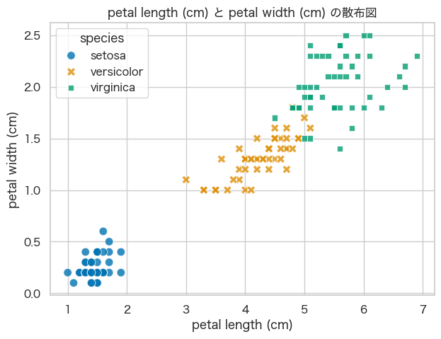
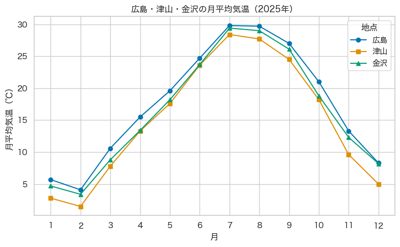

<!-- _class: cover -->
<!-- _paginate: false -->

# データ可視化とEDA
## 花の長さや幅から、何が分かる？

テーマ2

<!--
対応資料: ../notebook/lesson02_eda_template.ipynb
スライドで問いと見方を共有し、実習スライドでNotebookへ移る。
実習後は次のスライドに戻り、結果を受講者の言葉で確認する。
-->

---

# 今日、確かめたいこと

**花の種類によって、長さや幅はどう違う？**

- 1つの項目を見ると、どんな分布があるか
- 種類で分けると、違いが見えるか
- 2つの項目を組み合わせると、何が分かるか

最後に、気温のデータで「時間に沿った変化」も見ます。

<!-- 最初に問いを共有する。ここではグラフの種類を暗記させない。 -->

---

# EDAは、データを調べて手がかりを得ること

EDA：探索的データ分析

表で中身を確かめ、グラフで可視化し、規則性や関係を調べます。

> 「規則性がありそう」と気づいたら、
> 別の見方でも確かめます。

この回では、**図を根拠に、自分の言葉で説明すること**を目指します。

<!-- Notebook「EDAとは何か」に対応。予測精度の検証は今回の範囲外。 -->

---

# 講義と実習の進め方

スライドで、問いと見るポイントを確認します。

**「Notebookで実習」**が出たら、指定の見出しへ移ります。

実行したらスライドに戻り、分かったことを共有します。

<p class="small">Notebookは上から順に実行します。途中の説明やコードは、必要なときに読み返せます。コードをすべて覚える必要はありません。</p>

<!-- 実習は一つのまとまり単位で切り替える。環境設定はNotebook「実行の準備」を参照。 -->

---

# 数値を表に並べる

<div class="array-example">
<div>

| | 数学 | 英語 | 理科 |
| --- | ---: | ---: | ---: |
| 学生A | 80 | 65 | 70 |
| 学生B | 90 | 88 | 92 |
| 学生C | 75 | 60 | 78 |

</div>
<div>

```python
import numpy as np

scores = np.array([
    [80, 65, 70],  # 学生A
    [90, 88, 92],  # 学生B
    [75, 60, 78]   # 学生C
])
```

</div>
</div>

**1行は学生1人、1列は1科目。**

各行の数値を `[...]` でまとめ、3行を `np.array()` に渡します。

<!-- Notebookと同じ点数表とコード。内側のリスト1つが表の1行に対応する。
列の順番は数学・英語・理科。配列には数値だけが入り、科目名や学生名は入らない。
右側の学生名は対応を示すコメントであり、配列のデータではない。 -->

---

# 誰の平均？ 何の平均？

```python
scores.shape          # (3, 3)：3行3列
scores.mean(axis=1)   # 学生ごとの平均
scores.mean(axis=0)   # 科目ごとの平均
```

学生Aの平均は、**同じ行の3科目**をまとめます。

数学の平均は、**同じ列の3人分**をまとめます。

<p class="small">axis=1では各行の結果、axis=0では各列の結果が残ります。</p>

<!-- shapeを見てから、結果が誰・何に対応するかを確認する。axisの番号の暗記だけにしない。 -->

---

<!-- _class: practice -->

# Notebookで実習①：配列の計算

## 「NumPyで配列・行列を扱う」

1. 1次元配列、2次元配列のセルを順に実行する
2. 行ごとの平均と列ごとの平均を、点数表と照らす
3. `scores + 10` の結果を確認する

**確認すること：** 元の `scores` の値も変わった？

<!-- 開始:「NumPyで配列・行列を扱う」。終了:「配列全体への計算：ベクトル化」。
実行の準備は前の見出しを参照。初回は値を変えずに実行し、対応を確認してから試す。
演習Aに使うコードと出力を残す。 -->

---

# 配列全体に、同じ計算ができる

```python
v = np.array([10, 20, 30])
v * 2                     # [20, 40, 60]
```

配列の各要素に同じ計算を適用する書き方を、
**ベクトル化**と呼びます。

`scores + 10` は、新しい配列を作ります。
元の `scores` はそのままです。

<!-- 実習の確認を受けて説明する。代入して scores = scores + 10 とすれば更新される。
ここからは数値に「何を測ったか」という意味を付けて扱う。 -->

---

# Irisは、150件の花の測定記録

**1行が1つの花。測定値の単位は、すべてcm。**

| 測定項目（特徴量） | Notebookの列名 |
| --- | --- |
| がく片の長さ | `sepal length (cm)` |
| がく片の幅 | `sepal width (cm)` |
| 花びらの長さ | `petal length (cm)` |
| 花びらの幅 | `petal width (cm)` |

種類は setosa、versicolor、virginica の3種です。

<!-- 出典: Notebook「Irisデータセットの中身」。がく片はsepal、花びらはpetal。
Irisはscikit-learnに同梱。ここで自然界の全てのアヤメを代表すると解釈しない。 -->

---

# 測定値と、種類を表すラベル

| 種類の番号 `target` | 種類名 `species` | 件数 |
| ---: | --- | ---: |
| 0 | setosa | 50 |
| 1 | versicolor | 50 |
| 2 | virginica | 50 |

番号は、種類を区別するための記号です。

今回の表は、**4つの測定値 ＋ 番号 ＋ 種類名で6列**。

<p class="small">pandasのDataFrameを使うと、列名の付いた表として操作できます。</p>

<!-- targetとspeciesは同じ種類情報を別の形で表す。targetの平均に花の大きさの意味はない。
インデックスは6列に含めない。 -->

---

<!-- _class: practice -->

# Notebookで実習②：データの確認

## 「データを準備する」〜「データを確認する」

1. Irisを読み込み、表の1行を言葉で説明する
2. 行数・列数、種類ごとの件数、欠損件数を確認する
3. 基本統計量から、花びらの長さの平均・最小・最大を探す

**確認すること：** 平均だけで、値の集まり方も分かる？

<!-- 実行セルは「ライブラリ読み込みとデータ準備」「データ確認」。
基本統計量の全項目の説明はNotebookにある。まずmean/min/maxを読む。
演習Aでは4特徴量から1列を選ぶ。ここで花びらの長さを使うのは講義用の例。 -->

---

# 同じ平均でも、分布は違う

| 説明用のデータ | 値 | 平均 |
| --- | --- | ---: |
| A | 4, 5, 6 | 5 |
| B | 1, 5, 9 | 5 |

Aは5の近くに集まり、Bは広く散らばっています。

**どの範囲に、どれくらいあるか。**
それを調べるのが、分布を見るということです。

<!-- Irisの実測値ではなく、平均と分布の違いを示す説明用データ。 -->

---

# 区間に分けて、件数を数える

説明用の値：1.0, 1.2, 1.4, 1.5, 2.1, 2.5 cm

| 区間（階級） | 入る値 | 件数（度数） |
| --- | --- | ---: |
| 1.0以上、1.5未満 | 1.0, 1.2, 1.4 | 3 |
| 1.5以上、2.0未満 | 1.5 | 1 |
| 2.0以上、2.5以下 | 2.1, 2.5 | 2 |

これが**度数分布表**です。1.5は、2番目の区間に入ります。

<p class="small">今回の集計では、最後の階級だけ右端の値も含めます。</p>

<!-- Notebook「度数分布表から分布を調べる」と同じ説明用データ。
階級数は区間の個数、階級幅は区間の幅。Iris全体の集計とは区別する。 -->

---

<!-- _class: figure -->

# 件数を高さにすると、ヒストグラムになる



<p class="caption">横軸は花びらの長さ。縦軸は、その区間に入る花の件数。</p>

<!-- 出典: lesson02 Notebook「シンプルなヒストグラム」の保存済み出力。
花びらの長さ、18階級。等幅の階級なので棒の高さが件数に対応する。
花びらが長いほど棒が高い、という意味ではない。 -->

---

<!-- _class: practice -->

# Notebookで実習③：表と図の対応

## 「度数分布表から分布を調べる」
## 「度数分布表をヒストグラムで表す」

1. 初期設定の `feature` と `n_bins = 18` で実行する
2. 描画ライブラリを読み込み、全体のヒストグラムを描く
3. 表の1区間を選び、図の横位置と高さを照らす

**確認すること：** 度数を合計すると、何件になる？

<!-- この段階では「階級を細かくしすぎるとどうなるか」の直前で止める。
初回は間の「ライブラリ読み込み」を忘れず実行する。合計は150件。
featureとbin_edgesを表と図で共有していることを確認する。 -->

---

<!-- _class: figure -->

# 同じデータでも、区間の取り方で見え方が変わる



<p class="caption">18階級と180階級。細かい方が、分布を読みやすいだろうか？</p>

<!-- 出典: lesson02 Notebook「階級が細かすぎる例」の保存済み出力。
両図のデータと軸範囲は同じ。階級数を増やすと幅が狭くなり各階級の件数も変わる。
記録が0.1cm刻みであることも空の階級を生む。実際の花にその長さが存在しない証拠ではない。
18階級が常に最適という主張はしない。 -->

---

<!-- _class: practice -->

# Notebookで実習④：階級数を比べる

## 「階級を細かくしすぎるとどうなるか」

1. 18階級と180階級の図を描く
2. 棒の間に隙間が増える理由を考える
3. 余裕があれば `comparison_bins = [10, 30]` でも比べる

**確認すること：** どんな設定でも残る、大まかな特徴は？

<!-- comparison_binsは比較専用。演習Bのfeatureとbin_edgesはこのセルでは変わらない。
実習後、値の集まる範囲と読み取りやすさを比較する。棒の高さの一致を求めない。 -->

---

# ヒストグラムの山は、どの種類の花？

全体の分布には、花の種類の情報が隠れています。

**同じ測定項目・同じ区間のまま、種類で色を分けます。**

> 種類ごとの分布は、離れているだろうか？
> それとも、重なっているだろうか？

<!-- 次の図を出す前に予想してもらう。花びらの長さが今回の例。 -->

---

<!-- _class: figure -->

# 色分けすると、分布の重なりが見える



<p class="caption">setosaは短い側。versicolorとvirginicaには、重なる区間がある。</p>

<!-- 出典: lesson02 Notebook「種類ごとのヒストグラム」の保存済み出力。
花びらの長さ、18階級。同じ色の順序を以後の図でも保つ。
積み上げではなく種類ごとの件数を重ねている。色の重なりは同じ階級に入る値があること。
今回各種50件。総件数が異なるデータでは、件数差と分布の形を区別する必要がある。 -->

---

<!-- _class: practice -->

# Notebookで実習⑤：種類ごとの分布

## 「ヒストグラムを花の種類で色分けする」

1. 種類別ヒストグラムを実行し、重なる範囲を読む
2. 度数分布表の `feature` を別の測定項目に変える
3. **表、全体の図、種類別の図**の順に再実行する

**確認すること：** 項目を変えると、種類の重なりも変わる？

<!-- 見出しは実ファイルの表記に合わせてある。演習Bに使う列名・n_bins・表・コード・図を残す。
変数だけ変えて古い図と比べない。ライブラリ設定は初回実行済み。
講義の次の棒グラフは初期データからの集計なのでfeature変更には依存しない。 -->

---

<!-- _class: figure -->

# 種類ごとの平均を、棒の高さで比べる



<p class="caption">同じ測定項目の中で比較する。平均だけでは、個々の値の重なりは分からない。</p>

<!-- 出典: lesson02 Notebook「棒グラフ」の保存済み出力。
groupby('species')で種類に分けて平均。横軸は時間の順序ではない。
4項目はcmだが測定対象が異なるため、同じ項目内で種類を比較する。 -->

---

<!-- _class: figure -->

# このデータセットでは、各種類が3分の1



<p class="caption">50 ÷ 150 × 100 ≒ 33.3%。自然界の割合まで分かるわけではない。</p>

<!-- 出典: lesson02 Notebook「円グラフ」の保存済み出力。
構成比の分母を確認する。丸めた表示の合計は100%ぴったりにならない場合がある。
小さな差を正確に比較したいときは表や棒グラフも使う。 -->

---

<!-- _class: practice -->

# Notebookで実習⑥：平均と割合

## 「棒グラフで種類ごとの平均を比較する」
## 「円グラフで件数を割合として見る」

1. 種類ごとの平均の表と、棒の高さを照らす
2. 円グラフの割合を、種類ごとの件数と照らす

**確認すること：** それぞれの図は、どんな問いに答えている？

<!-- 答えの例: 棒グラフは種類ごとの平均差、円グラフはデータ内の構成比。
ここまでの図は授業で確認する。レポート必須の2図と混同させない。 -->

---

# 長さと幅を、一緒に見る

散布図では、**1点が1つの花**を表します。

| 点の情報 | 表すもの |
| --- | --- |
| 横の位置 | 花びらの長さ |
| 縦の位置 | 花びらの幅 |
| 色と記号 | 花の種類 |

1項目の分布では重なった種類も、見分けやすくなるでしょうか？

<!-- Notebook「散布図で2つの測定項目を組み合わせる」。図を見る前に1点の意味を共有する。 -->

---

<!-- _class: figure -->

# 2つの項目で見る、種類ごとの集まり



<p class="caption">点の集まりの向きと、種類どうしが重なる範囲に注目する。</p>

<!-- 出典: lesson02 Notebook「散布図」の保存済み出力。
setosaは左下に離れて見える。versicolorとvirginicaには重なりが残る。
同じ座標では点が重なるので見える点数と件数は一致しない場合がある。
全体の右上がりと、各種類の内部の関係の強さを区別する。因果関係はこの図だけでは言えない。 -->

---

<!-- _class: practice -->

# Notebookで実習⑦：組み合わせを変える

## 「散布図で2つの測定項目を組み合わせる」

1. 花びらの長さと幅で描き、種類の重なりを読む
2. `x_feature` と `y_feature` を別の組み合わせに変える
3. 種類別ヒストグラムと散布図を比べる

**確認すること：** どの組み合わせが、見分ける手がかりになりそう？

<!-- 演習Cに対応。演習Bと1項目を共通にすると比較しやすい。
レポートに使う軸の列名と図が一致するよう再実行する。
見た目の分離は、新しいデータに対する予測精度の保証ではない。 -->

---

# 図から言えることを、書き分ける

**事実**
花びらの長さと幅の散布図では、setosaの点が他の2種から離れている。

**解釈**
花びらの長さと幅は、setosaを見分ける手がかりになりそう。

**限界**
新しい花をどれくらい正しく分類できるかは、この図だけでは分からない。

<!-- 初期設定の図についての例。学生は選んだ軸の図を根拠に書く。
演習Cでは演習Bのヒストグラムも根拠に含める。この文の丸写しを求めない。 -->

---

# 月ごとの変化を見るには？

ここからは、花の測定記録から**気温の記録**へ切り替えます。

- 1行は1か月、2025年1〜12月の12行
- 広島・津山・金沢の各地点の月平均気温（℃）

**時間の順に並ぶ値**は、折れ線で結ぶと変化を追いやすくなります。

<p class="small">CSVをpandasで読み込みます。データはNotebookのdataフォルダにあります。</p>

<!-- 出典: ../notebook/data/monthly_mean_temperature_2025.csv と ../notebook/data/README.md。
気象庁の各観測地点の月平均値。市全域の平均や平年値ではない。
月平均気温は最高・最低気温の単純平均ではない。 -->

---

<!-- _class: figure -->

# 線の変化と、同じ月の地点差



<p class="caption">各線の高い月・低い月と、同じ月の点の高さの差を読む。</p>

<!-- 出典: lesson02 Notebook「気象データの折れ線グラフ」の保存済み出力。
一次出典と転記条件: ../notebook/data/README.md。各地点の2025年の月平均気温。
問いへの回答を受講者に出してもらってから、Notebookの表で確認する。 -->

---

<!-- _class: practice -->

# Notebookで実習⑧：気温の変化

## 「折れ線グラフで月平均気温の変化を見る」

1. CSVを読み込み、表と折れ線グラフを表示する
2. 各地点で、気温が最も高い月と低い月を探す
3. 地点間の差が大きい月と小さい月を比べる

**確認すること：** この1年分の図から、温暖化まで言える？

<!-- CSVの配置方法はNotebookに記載。Colabではdataフォルダにアップロードする。
初期CSVでは3地点とも最高は7月、最低は2月。3地点の最大最小差は11月が最大3.7℃、
6月が最小1.1℃。数値は必要に応じて表で確かめる。
実習後、次ページでデータの粒度と期間の限界を共有する。 -->

---

# 月平均と1年分のデータで分かる範囲

月平均では、**日ごとの気温の変動**は分かりません。

線は隣り合う月の点を結んでいます。
月の間の値を直接観測した線ではありません。

**2025年の1年分**なので、長期的な温暖化や、
複数年の平均的な気候は、この図だけでは判断できません。

<!-- Notebook「図の読み方」に対応。観測期間と集計単位を確かめる習慣につなげる。 -->

---

# 問いに合わせて、グラフを選ぶ

| 知りたいこと | 使ったグラフ |
| --- | --- |
| どの範囲に値が多い？ | ヒストグラム |
| 種類ごとの平均はどう違う？ | 棒グラフ |
| 全体のうち、どれくらい？ | 円グラフ |
| 2つの項目には、どんな関係がある？ | 散布図 |
| 時間に沿って、どう変わる？ | 折れ線グラフ |

**同じデータでも、問いが変われば、見る図も変わります。**

<!-- ここで講義冒頭の「花の種類による長さ・幅の違い」に戻り、分かったことを短く共有する。 -->

---

# レポートは、演習A〜Cを1本に

| 演習 | 必須の内容 |
| --- | --- |
| A：配列とデータ確認 | 配列のコード・出力、Irisの説明・件数・基本統計量 |
| B：分布 | 列名・階級数、コード・度数分布表・種類別ヒストグラム |
| C：関係 | 軸と1点の意味、コード・散布図、図を根拠にした考察 |

必須の図は、**種類別ヒストグラムと散布図の2図**です。

<p class="small">Bでは分布と重なり、Cでは点の集まりと重なりを説明します。Cの考察はBとCの図を使い、事実・解釈・限界に分けます。</p>

<!-- 正式な要件はNotebook「まとめとレポート」「演習A〜C」を参照。
A: scores.shapeとaxis=1/0のコード・出力と違い、Iris1行と4特徴量の意味、
行列数・種ごとの件数、選んだ1列の平均/最小/最大。
B: 度数分布表を作るコードと表、種類別ヒストグラムのコードと図。
C: 散布図のコードと図、点の集まりと重なり、Bとの比較と事実/解釈/限界。
棒・円・折れ線も授業中に実行するが、これらのレポート掲載は任意。 -->

---

<!-- _class: practice -->

# Notebookで確認：レポートの仕上げ

## 「まとめとレポート」

- 本文テンプレートを使い、Word形式でまとめる
- 図や表は、選んだ列名・階級数・軸の設定とそろえる
- コードと結果に、自分の説明を添える
- 氏名・提出日と「分からなかった点」も記す

提出方法と詳細は、Notebookで確認してください。

<!-- 本文構成: 学んだことの要約、演習の結果と説明、分からなかった点。
提出先はNotebookに記載。締切はここで新たに設定しない。
提出前には基本学習のコードを上から再実行し、設定と結果の一致を確認する。
巻末の箱ひげ図、相関ヒートマップ、pairplot、IQR、レーダーチャートは任意の発展。 -->

---

# 花の長さや幅から、何が分かった？

自分が作った図を根拠に、説明してみましょう。

> どの種類が、どんな値の範囲に集まった？
>
> 項目を組み合わせると、何が見えた？
>
> まだ、この分析だけでは言えないことは？

<!-- 最後に一人またはペアで短く説明する。初期設定の結論ではなく、本人の図に対応する説明を確認する。 -->
