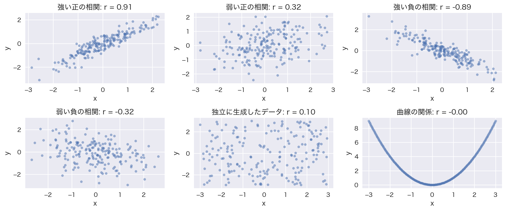
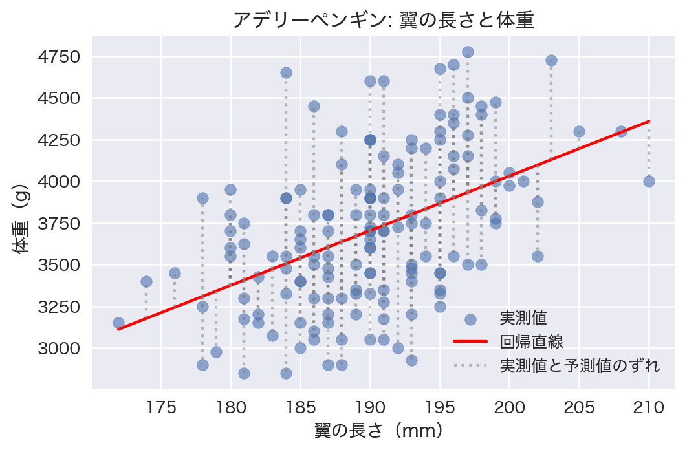
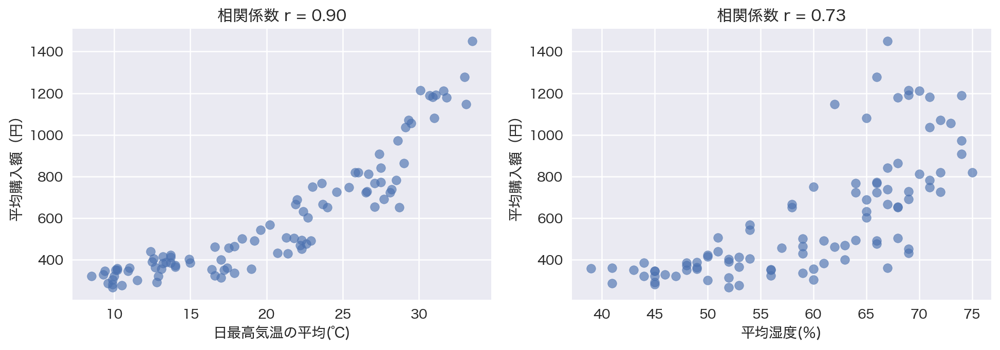
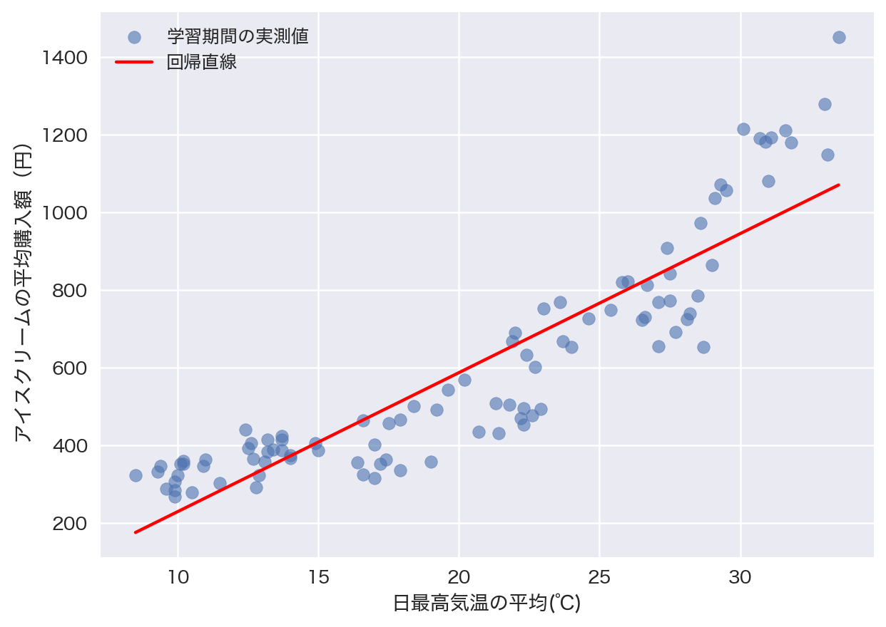
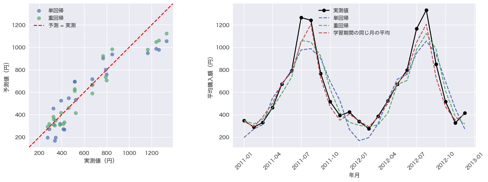
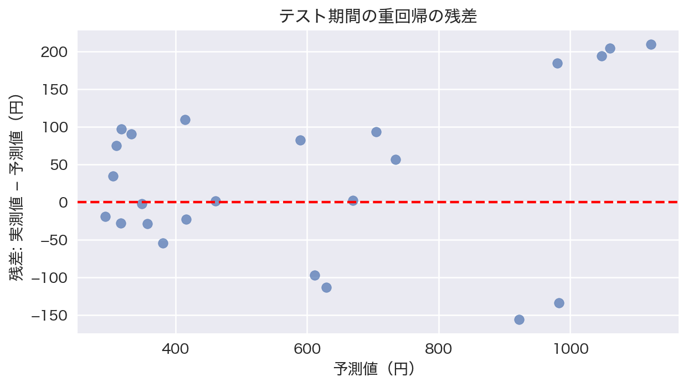

<!-- _class: cover -->

<!-- _paginate: false -->

# 回帰分析
## データから数値を予測する

テーマ3

<!-- 対応資料: ../notebook/lesson03_regression_basic_template.ipynb。問いと図の見方を共有し、実習ページでNotebookに移る。 -->

---

# 今日、確かめたいこと

**気温が分かると、購入額をどこまで予測できる？**

- 散布図と相関係数で、関係を調べる
- 回帰式を学習し、新しい入力から数値を予測する
- 学習に使わなかった期間で、予測のずれを調べる

最後は、翌年の電力需要の予測で試します。

---

# 回帰で予測するもの

回帰は、入力から **数値** を予測する方法です。

| 例 | 説明変数（入力） | 目的変数（予測する値） |
| --- | --- | --- |
| ペンギン | 翼の長さ | 体重 |
| アイスクリーム | 気温や湿度 | 平均購入額 |
| 電力需要 | 気温・相対湿度・日照時間 | 1時間平均の電力需要 |

予測値と実測値は、一般には一致しません。

---

# 講義と実習の進め方

スライドで、考え方と図の見方を確認します。

**「Notebookで実習」** が出たら、指定の見出しへ移ります。

本文は上から順に実行し、結果を確認したら戻ります。

> コードの暗記より、入力・出力と結果の意味を押さえます。

---

# 相関係数

相関係数 $r$ は、**直線的な関係の向きと強さ** を表します。

| 値 | 散布図の傾向 |
| --- | --- |
| $+1$ に近い | 強い右上がり |
| $-1$ に近い | 強い右下がり |
| $0$ に近い | 直線的な関係が弱い |

負の相関でも、絶対値が大きければ強い相関です。

---

<!-- _class: figure -->

# 散布図と相関係数の対応



<div class="caption">人工データの例。右下は相関係数がほぼ0でも、曲線の関係があります。</div>

---

# 相関から分かることの範囲

**相関係数と散布図を一緒に確認します。**

- 曲線の関係は、相関係数だけでは捉えにくい
- 少数の極端な値が、相関係数に影響する場合がある
- 相関だけで、原因と結果の関係は証明できない

気温と購入額には、季節など共通の要因も関わります。

---

<!-- _class: practice -->

# Notebookで実習 ①

**2. 散布図と相関係数**

1. 6つの散布図を表示する
2. 正負の相関と、絶対値の大きさを比べる
3. 曲線の図で、相関係数だけでは分からないことを考える

実行したらスライドに戻り、結果を確認します。

---

# 単回帰の式

説明変数が1つの線形回帰を **単回帰** と呼びます。

$$\hat{y} = wx + b$$

| 記号 | 意味 | ペンギンの例 |
| --- | --- | --- |
| $x$ | 入力 | 翼の長さ（mm） |
| $\hat{y}$ | 予測値 | 体重の予測値（g） |
| $w$ | 傾き | 1mm長い入力での予測値の変化 |
| $b$ | 切片 | 入力が0のときの式の値 |

---

# ペンギンの翼の長さと体重

Palmer Penguinsの **Adelieだけ** を使います。

- 1行は1羽の記録
- 入力は翼の長さ、予測するのは体重
- この2列の欠損を除いた151羽を使用
- 種による違いを混ぜないよう、1種類に絞る

<p class="small">出典: Palmer Penguins。観測はKristen Gorman氏とPalmer Station LTER。データはCC0。</p>

<!-- 出典: https://allisonhorst.github.io/palmerpenguins/ 。列・抽出方法はNotebook「3. ペンギンの翼の長さと体重で単回帰を試す」に対応。 -->

---

# 学習と予測のコード

```python
X = adelie[['flipper_length_mm']]  # 表: (151, 1)
y = adelie['body_mass_g']          # 1列: (151,)
model = LinearRegression()
model.fit(X, y)
model.predict(X)
```

`fit(X, y)` で式の係数を求め、`predict(X)` で予測します。

傾きは `coef_`、切片は `intercept_` で確認できます。

<!-- コードは要点のみ。importとデータの準備を含む完全なコードはNotebookにある。説明変数は2次元、目的変数はこの例では1次元。 -->

---

<!-- _class: figure -->

# ペンギンの回帰直線



<div class="caption">灰色の縦線は、各個体の実測値と予測値のずれです。</div>

---

# 傾きと切片の読み取り

体重の予測値（g） ≈ **32.83 × 翼の長さ（mm） − 2535.84**

- 傾きは約32.83 g/mm
- 翼が1mm長い入力では、予測値が約32.83g大きくなる
- 190mmでの予測は約3702.2g

切片は翼の長さ0mmでの式の値です。

**観測範囲外なので、実際の体重として解釈しません。**

<!-- 値は丸めて表示。実際のpredictは丸める前の係数で計算する。因果効果や個体の必然的な体重を表す式ではない。 -->

---

# 最小二乗法

学習では、実測値と予測値の **ずれの2乗の合計** を小さくします。

$$\sum_{i=1}^{n}(y_i-\hat{y}_i)^2$$

- $n$ はデータの件数、$y_i$ は実測値、$\hat{y}_i$ は予測値
- 正負のずれが打ち消し合わないよう、2乗する
- すべての点を通らなくてもよい

この方法で、傾き $w$ と切片 $b$ を求めます。

---

<!-- _class: practice -->

# Notebookで実習 ②

**3. ペンギンの翼の長さと体重で単回帰を試す**

1. 回帰式と、図の縦方向のずれを確認する
2. 翼の長さを172〜210mmの範囲で変えて予測する
3. 傾きの単位と、予測値の変化を説明する

実行したらスライドに戻り、結果を確認します。

---

# 内挿と外挿

| 予測する入力 | 呼び方 | 注意点 |
| --- | --- | --- |
| 観測した範囲の中 | 内挿 | 範囲内でも予測にはずれがある |
| 観測した範囲の外 | 外挿 | 同じ関係が続くとは限らない |

翼の長さ0mmで式を計算できても、妥当な予測とは限りません。

**学習データへの当てはまりと、未知データの予測性能も区別します。**

---

# アイスクリームのデータ

`ice.csv`：2003〜2012年の120か月。**1行は1か月** です。

| 役割 | 使用する値 |
| --- | --- |
| 目的変数 | アイスクリームの平均購入額（円） |
| 説明変数 | 日最高気温の平均（℃）、月の降水量の合計（mm） |
| 説明変数 | 平均湿度（%）、日最高気温25℃以上の日数（日） |

<p class="small">地域・購入額の集計対象・一次出典は元教材に記載がありません。<br>店舗の売上や個人の購入額とは断定せず、教材のデータとして扱います。</p>

---

# 学習期間とテスト期間

| 期間 | 件数 | 役割 |
| --- | ---: | --- |
| 2003〜2010年 | 96か月 | 関係を調べ、式を学習する |
| 2011〜2012年 | 24か月 | 学習に使わず、最後に評価する |

今回は **時間順** に分け、後の期間への予測を試します。

散布図・相関係数・基準となる平均は、学習期間だけで求めます。

---

<!-- _class: practice -->

# Notebookで実習 ③

**4. アイスクリームのデータを読む／5. 学習期間とテスト期間を分ける**

1. 表の列名・単位・欠損を確認する
2. 学習96件、テスト24件になっていることを確認する
3. なぜ未来のデータを学習に混ぜないか考える

実行したらスライドに戻り、結果を確認します。

---

<!-- _class: figure -->

# 気象と購入額の関係



<div class="caption">学習期間の96か月。1点は1か月で、気温が同じくらいでも購入額はばらつきます。</div>

---

# 気温による単回帰

```python
x_col = '日最高気温の平均(℃)'
single_model = LinearRegression()
single_model.fit(train_df[[x_col]], y_train)
new_weather = pd.DataFrame({x_col: [25.0]})
single_model.predict(new_weather)
```

**25℃は、その月の日最高気温の平均** を表します。

ある1日の気温から、個人の購入額を予測する例ではありません。

---

<!-- _class: figure -->

# 気温と平均購入額の回帰直線



<div class="caption">学習期間の観測範囲に直線を描きます。予測値は各月の購入額と必ず一致するわけではありません。</div>

---

<!-- _class: practice -->

# Notebookで実習 ④

**6. 気象データと購入額の関係を見る／7. 気温から購入額を予測する（単回帰）**

1. 散布図と相関係数の向きを確かめる
2. 回帰式の傾きと単位（円/℃）を確認する
3. 学習範囲内で入力する気温を変え、予測値を比べる

実行したらスライドに戻り、結果を確認します。

---

# 重回帰

説明変数を複数使う線形回帰を **重回帰** と呼びます。

$$\hat{y} = w_1x_1 + w_2x_2 + \cdots + w_px_p + b$$

$p$ は説明変数の数で、今回は $p=4$ です。<br>気温・降水量・湿度・高温日数を使います。

```python
multi_model = LinearRegression()
multi_model.fit(train_df[feature_columns], y_train)
```

説明変数を増やしても、未知データの誤差が必ず減るとは限りません。

---

# 重回帰の係数の意味

気温の係数は、基本設定で **約17.52円/℃** です。

> 他の3つの入力を固定すると、気温が1℃高い入力で
> 購入額の予測値が約17.52円増える。

- 他の変数も含めた式の性質を表す
- 単位が異なる係数の絶対値だけで、重要度を比べない
- 係数を、その変数の因果効果とは解釈しない

---

# 相関と重回帰の係数

湿度は購入額と正の相関がありますが、重回帰の係数は負です。

| 見ているもの | 関係の捉え方 |
| --- | --- |
| 相関 | 2つの変数だけの関係 |
| 重回帰の係数 | 他の説明変数を固定した式の関係 |

説明変数どうしに強い直線的な関係がある状態を **多重共線性** と呼びます。
その場合、データの変化によって係数が大きく変わることがあります。

---

<!-- _class: practice -->

# Notebookで実習 ⑤

**8. 複数の気象変数を使う（重回帰）**

1. 4つの説明変数の係数と切片を表示する
2. 気温の係数の意味を、単位付きで説明する
3. 説明変数どうしの相関を確認する

実行したらスライドに戻り、結果を確認します。

---

# 小さな例で誤差を確かめる

残差を「実測値 − 予測値」とします。

| 実測値（円） | 予測値（円） | 残差（円） | 残差の2乗（円²） |
| ---: | ---: | ---: | ---: |
| 500 | 400 | +100 | 10,000 |
| 500 | 600 | −100 | 10,000 |
| 500 | 200 | +300 | 90,000 |

正負のまま平均すると、過大予測と過小予測が打ち消し合います。
学習時と同じように、残差を2乗してから集計します。

---

# 二乗誤差で評価する：RMSE

RMSEは、**残差の2乗の平均の平方根** です。
学習と同じ二乗誤差を使い、**テストデータ**でずれを確かめます。

$$RMSE = \sqrt{\frac{1}{n}\sum_{i=1}^{n}(y_i-\hat{y}_i)^2}$$

- 2乗したずれを平均し、平方根で元の単位（円）に戻す
- 小さいほど良い。大きなずれの影響を強く受ける
- 先ほどの例：$\sqrt{(10000+10000+90000)/3}\approx 191.5$ 円

<p class="small">RMSEが100円でも、すべての月の誤差が100円以内という意味ではありません。</p>

---

# 比較する簡単な予測方法

回帰モデルと一緒に、**平均を使う2つの基準** も評価します。

| 方法 | 予測に使う値 |
| --- | --- |
| 学習期間の平均 | 96か月の購入額の平均を毎月予測 |
| 学習期間の同じ月の平均 | 例えば7月なら、学習期間の7月の平均 |

平均の計算にも、テスト期間の購入額は含めません。

季節性を使うだけで、どこまで予測できるかを比べます。

---

# テスト期間の評価結果

| 方法 | RMSE（円） |
| --- | ---: |
| 学習期間の平均 | 327.0 |
| 学習期間の同じ月の平均 | 67.5 |
| 単回帰 | 146.1 |
| 重回帰 | 108.4 |

**同じ月の平均が、この期間では最も小さい誤差でした。**

重回帰が単回帰より良くても、簡単な基準との比較が必要です。

<!-- Notebookの初期設定を再実行して計算。学習2003〜2010年、テスト2011〜2012年。順位はこの期間の結果であり、将来の全期間への保証ではない。 -->

---

<!-- _class: practice -->

# Notebookで実習 ⑥

**9. 学習に使わなかった期間で評価する**

1. 小さな例で、残差・2乗誤差からRMSEを計算する
2. テスト期間の4つの方法のRMSEを比べる
3. 「変数を増やせば必ず良い」と言えるか考える

実行したらスライドに戻り、結果を確認します。

---

<!-- _class: figure -->

# 予測と実測の比較



<div class="caption">左は対角線に近いほど実測と予測が近い。右は同じ月の値を比べ、ずれが大きい時期を探します。</div>

---

<!-- _class: figure -->

# 残差からずれを読む



<div class="caption">残差 = 実測値 − 予測値。正なら過小予測、負なら過大予測です。</div>

---

<!-- _class: practice -->

# Notebookで実習 ⑦

**10. 予測と実測を図で比べる／残差から予測のずれを読む**

1. 対角線の上・下が、過大予測・過小予測のどちらか確認する
2. 重回帰でずれが大きい月を、図と表から探す
3. その月の残差の符号を説明する

実行したらスライドに戻り、結果を確認します。

---

# 評価結果の限界

**アイスクリームの評価結果は、2011〜2012年についてのものです。**

- 別の年や地域で、同じ精度になるとは限らない
- テスト結果を見て何度も調整すると、その期間に合わせてしまう
- 調整には、学習期間の中に別の検証期間を設ける

月が始まる前の予測では、気象値そのものの予報誤差も加わります。

---

# 演習は東京エリアの電力需要

**気象データから、電力需要をどこまで推定できる？**

- 2024〜2025年の2年分。元データの1行は1時間
- 目的変数は東京エリアの電力需要（万kW）
- 入力は東京の気温・相対湿度・日照時間
- 演習Aでは2年分全体の散布図で関係を調べる

<p class="small">出典：東京電力パワーグリッド・気象庁。各演習は単独で実行できます。</p>

<!-- notebook/datasets/tepco_power_weather_2024_2025.csv。全17,544時間から、使用する3気象列に欠測がある1行を除外。Aは17,543時間、Bは2024年8,783時間で学習し、2025年8,760時間で評価。気象は東京1地点、需要は東京エリア全体。時間区間終了時の気象を結合し、気象観測値が分かった条件で推定する。 -->

---

<!-- _class: practice -->

# 演習A：気象と電力需要の関係

**2年分の散布図・回帰直線・相関係数を確認します。**

1. 演習Aのコードセルをそのまま実行する
2. 気温・相対湿度・日照時間から1つ選ぶ
3. 相関係数・回帰直線の向き・点のばらつきを説明する

提出：コード・回帰直線を重ねた散布図・相関係数の表と説明。

---

<!-- _class: practice -->

# 演習B：単回帰と重回帰の予測結果

**2024年だけでモデルを作り、2025年の予測を比べます。**

1. 演習Bのコードセルをそのまま実行する
2. 単回帰と重回帰のRMSEを、具体的な数値で比較する
3. 時系列図か比較図を1つ選び、読み取れたことを2〜3文で説明する

<p class="small">折れ線は日平均、散布図とRMSEは1時間ごとの値を使います。</p>

提出：コード・時系列図・RMSEの表・比較図と説明。

---

# レポートの構成と提出

**提出物はWord形式のレポート1本です。**

| 節 | 書く内容 |
| --- | --- |
| 1. 学んだことの要約 | 学んだ概念を自分の言葉で説明 |
| 2. 演習の結果と説明 | 演習A・Bのコード・表・図・数値と説明 |
| 3. 分からなかった点 | 詰まった場所や疑問。なければ「なし」 |

Notebookのテンプレートを使い、氏名・提出日・出典を記入します。

<p class="small">提出先：大学の電子メール kazuhisa_fujita@komatsu-u.ac.jp</p>

---

<!-- _class: practice -->

# Notebookで実習 ⑧

**まとめとレポート／演習A・B／レポート本文（テンプレート）**

1. 演習A・Bのコードをそれぞれ実行する
2. 各欄にコード・結果と、自分の説明を入れる
3. 単位・Bの期間の分け方・提出前チェックを確認する

実行したらスライドに戻り、結果を確認します。

---

# 今日のまとめ

**データの関係を調べ、式を作り、学習に使わなかった期間で確かめました。**

- 相関係数は、散布図と一緒に読む
- 単回帰と重回帰は、入力から数値を予測する
- 予測のずれは、RMSEと比較図で調べる
- 平均による基準と比べ、結果が通用する範囲を考える

レポートでは、自分の図や数値を根拠に説明しましょう。

---

# 資料とデータの出典

- 本文・演習コード：`notebook/lesson03_regression_basic_template.ipynb`
- ペンギン：[Palmer Penguins](https://allisonhorst.github.io/palmerpenguins/)（CC0）
- アイスクリーム：既存教材から引き継いだ `ice.csv`
- 電力需要：[東京電力パワーグリッド「でんき予報」](https://www.tepco.co.jp/forecast/html/download_year-j.html)
- 気象：[気象庁「過去の気象データ・ダウンロード」](https://www.data.jma.go.jp/risk/obsdl/index.php)

図と評価値は、教材の同梱データと初期設定から計算しています。

列の説明・取得条件：`notebook/datasets/README.md`
