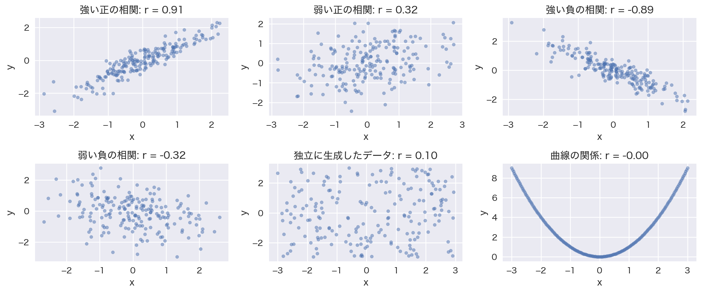
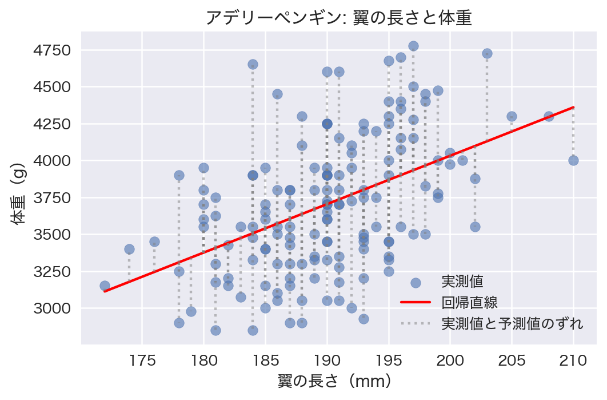
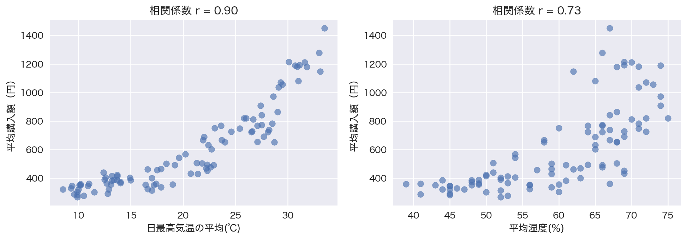
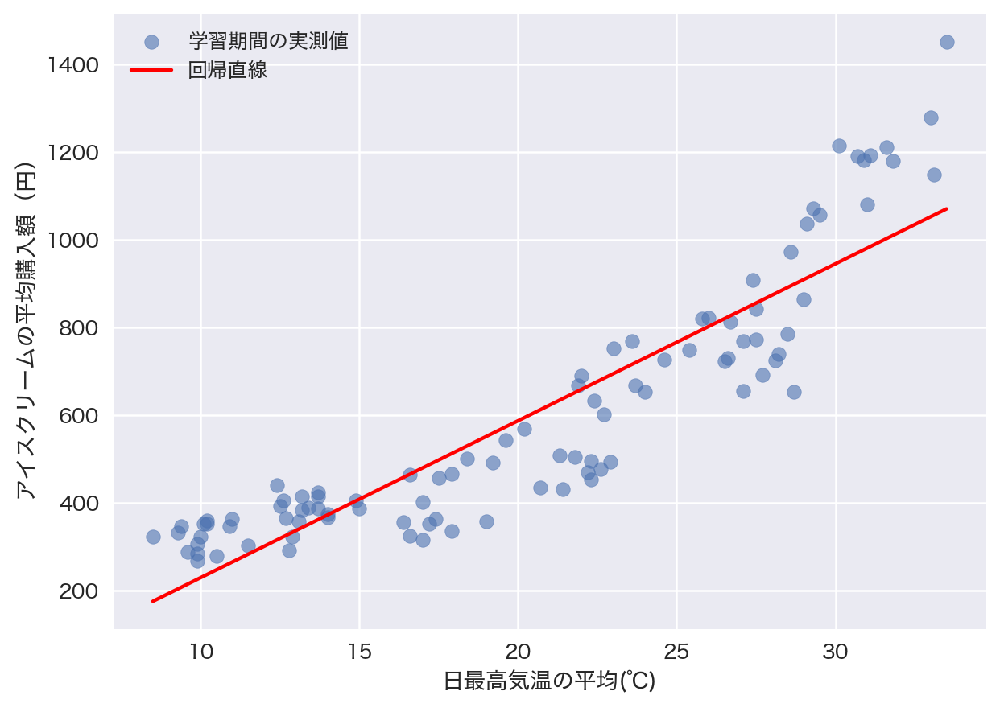
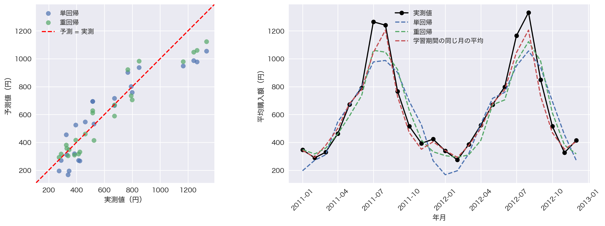
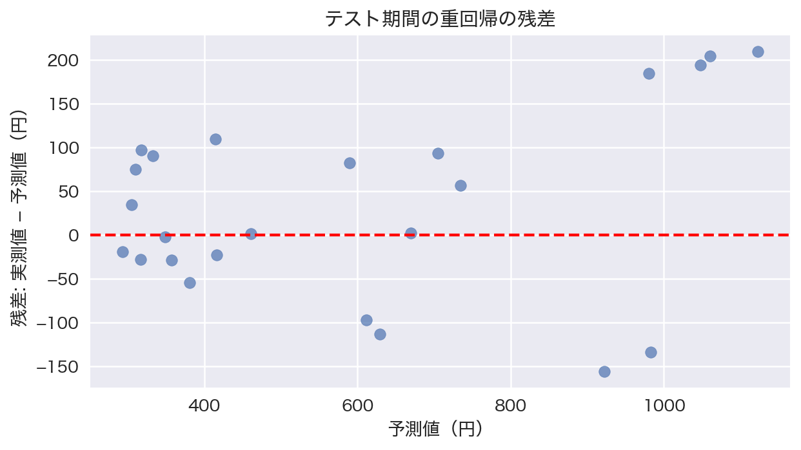

<!-- _class: cover -->

<!-- _paginate: false -->

# 回帰分析
## データから数値を予測する

テーマ3

<!-- 対応資料: ../notebook/lesson03_regression_basic_template.ipynb。問いと図の見方を共有し、実習ページでNotebookに移る。 -->

---

# 前回の「予測できるかも」を確かめる

前回は、気温とアイスの購入額を **散布図と回帰直線** で表しました。

<div class="flow">
<div class="box"><strong>関係を見る</strong>散布図・相関係数</div>
<div class="arrow">→</div>
<div class="box"><strong>式を求める</strong>Pythonで学習・予測</div>
<div class="arrow">→</div>
<div class="box"><strong>確かめる</strong>別の期間で誤差を評価</div>
</div>

**今回は、自分で実行し、予測がどのくらい当たるか確かめます。**

<p class="small">ペンギンで操作を確認 → アイスで予測を評価 → 電力需要で演習</p>

---

# 回帰で予測するもの

回帰は、入力から **数値** を予測する方法です。

| 例 | 説明変数（入力） | 目的変数（予測する値） |
| --- | --- | --- |
| ペンギン | 翼の長さ | 体重 |
| アイスクリーム | 気温や湿度 | 平均購入額 |
| 電力需要(課題) | 気温・相対湿度・日照時間 | 1時間平均の電力需要 |

予測値と実測値は、一般には一致しません。

---

# 講義と実習の進め方

スライドで、考え方と図の見方を確認します。

**「Notebookで実習」** が出たら、指定の見出しへ移ります。

本文は上から順に実行し、結果を確認したら戻ります。

> コードの暗記より、入力・出力と結果の意味を押さえます。

---

# 相関係数

前回の復習：Pearsonの相関係数 $r$ は、**直線的な関係の向きと強さ** を表します。

| 値 | 散布図の傾向 |
| --- | --- |
| $+1$ に近い | 強い右上がり |
| $-1$ に近い | 強い右下がり |
| $0$ に近い | 直線的な関係が弱い |

負の相関でも、相関係数の絶対値が大きければ強い相関です。

---

<!-- _class: figure -->

# 散布図と相関係数の対応



<div class="caption">人工データの例。右下は相関係数がほぼ0でも、曲線の関係があります。</div>

---

# 相関から分かることの範囲

**相関係数と散布図を一緒に確認します。**

- 相関係数がほぼ0でも、曲線の関係がある場合がある
- 少数の極端な値が、相関係数に影響する場合がある
- 相関だけで、原因と結果の関係は証明できない

気温と購入額には、季節など共通の要因も関わります。

---

<!-- _class: practice -->

# Notebookで実習 ①

**2. 散布図と相関係数**

1. 6つの散布図を表示する
2. 正負の相関と、絶対値の大きさを比べる
3. 曲線の図で、相関係数だけでは分からないことを考える

実行したらスライドに戻り、結果を確認します。

---

# 前回の記号と、今回の記号

同じ意味でも、資料やライブラリによって記号が変わります。

| 意味 | 前回の資料 | 今回のスライド・Notebook |
| --- | --- | --- |
| 入力 | $x$ | $x$ |
| 実測値（観測値） | $t$ | $y$ |
| 予測値 | $y$ | $\hat{y}$（ワイハット） |
| 傾き・切片 | $a, b$ | $w, b$ |

**実測値 $y$ と予測値 $\hat{y}$ を区別して読みます。**

---

# 単回帰の式

説明変数が1つの線形回帰を **単回帰** と呼びます。
傾き $w$ と切片 $b$ は、データから決める **パラメータ** です。

$$\hat{y} = wx + b$$

| 記号 | 意味 | ペンギンの例 |
| --- | --- | --- |
| $x$ | 入力 | 翼の長さ（mm） |
| $\hat{y}$ | 予測値 | 体重の予測値（g） |
| $w$ | 傾き | 1mm長い入力での予測値の変化 |
| $b$ | 切片 | 入力が0のときの式の値 |

---

# ペンギンの翼の長さと体重

Palmer Penguinsの **Adelieだけ** を使います。

- 1行は1羽の記録
- 入力は翼の長さ、予測するのは体重
- この2列の欠損を除いた151羽を使用
- 種による違いを混ぜないよう、1種類に絞る

<p class="small">出典: Palmer Penguins。観測はKristen Gorman氏とPalmer Station LTER。データはCC0。</p>

<!-- 出典: https://allisonhorst.github.io/palmerpenguins/ 。列・抽出方法はNotebook「3. ペンギンの翼の長さと体重で単回帰を試す」に対応。 -->

---

<!-- _class: compact -->

# 「式を求める」と「式に入力する」

```python
X = adelie[['flipper_length_mm']]  # 表: (151, 1)
y = adelie['body_mass_g']          # 1列: (151,)
model = LinearRegression()
model.fit(X, y)
model.predict(X)
```

| 操作 | 渡すもの | 得られるもの |
| --- | --- | --- |
| `fit(X, y)`：学習 | 入力と実測値 | 傾き `coef_` と切片 `intercept_` |
| `predict(X)`：予測 | 入力だけ | 体重の予測値 $\hat{y}$ |

<p class="small">この例は学習した151羽への当てはまりを見ます。未知データでの評価は後半で行います。</p>

<!-- コードは要点のみ。importとデータの準備を含む完全なコードはNotebookにある。説明変数は2次元、目的変数はこの例では1次元。 -->

---

<!-- _class: figure -->

# ペンギンの回帰直線



<div class="caption">点は1羽の実測値。直線上の同じ翼の長さの位置が予測値です。<br>点と直線の縦の距離が、実測値と予測値のずれを表します。</div>

---

# 傾きと切片の読み取り

体重の予測値（g） ≈ **32.83 × 翼の長さ（mm） − 2535.84**

- 傾きは約32.83 g/mm
- 翼が1mm長い入力では、予測値が約32.83g大きくなる
- 190mmでの予測は約3702.2g

切片は翼の長さ0mmでの式の値です。

**観測範囲外なので、実際の体重として解釈しません。**

<!-- 値は丸めて表示。実際のpredictは丸める前の係数で計算する。因果効果や個体の必然的な体重を表す式ではない。 -->

---

# 学習：二乗したずれを小さくする

実測値と予測値の **ずれの2乗の合計** が最小になるように、傾きと切片を求めます。

$$\sum_{i=1}^{n}(y_i-\hat{y}_i)^2$$

- $y_i-\hat{y}_i$ は、$i$ 番目の実測値と予測値のずれ
- 正負が打ち消し合わないよう、ずれを2乗して足す
- `fit(X, y)` が、この計算に基づいて係数を求める

この方法を **最小二乗法** と呼びます。

<p class="small">n は学習データの件数。同じデータでは、合計を最小にする係数と、前回の平均二乗誤差を最小にする係数は同じです。</p>

---

<!-- _class: practice -->

# Notebookで実習 ②

**3. ペンギンの翼の長さと体重で単回帰を試す**

1. 回帰式と、図の縦方向のずれを確認する
2. 翼の長さを172〜210mmの範囲で変えて予測する
3. 傾きの単位と、予測値の変化を説明する

実行したらスライドに戻り、結果を確認します。

---

# 内挿と外挿

| 予測する入力 | 呼び方 | 注意点 |
| --- | --- | --- |
| 観測した範囲の中 | 内挿 | 範囲内でも予測にはずれがある |
| 観測した範囲の外 | 外挿 | 同じ関係が続くとは限らない |

翼の長さ0mmで式を計算できても、妥当な予測とは限りません。

**次はアイスのデータで、学習に使わなかった期間の予測を試します。**

---

# アイスクリームのデータ

`ice.csv`：2003〜2012年の120か月。**1行は1か月** です。

| 役割 | 使用する値 |
| --- | --- |
| 目的変数 | アイスクリームの平均購入額（円） |
| 説明変数 | 日最高気温の平均（℃）、月の降水量の合計（mm） |
| 説明変数 | 平均湿度（%）、日最高気温25℃以上の日数（日） |

<p class="small">地域・購入額の集計対象・一次出典は元教材に記載がありません。<br>店舗の売上や個人の購入額とは断定せず、教材のデータとして扱います。</p>

---

# テストデータが必要な理由

**学習データで誤差が小さくても、未知のデータで小さいとは限りません。**

| データ | 確かめること |
| --- | --- |
| 学習データ（訓練データ） | 係数を求めるために使ったデータへの当てはまり |
| テストデータ | 学習に使わなかったデータに対する予測性能 |

実際の予測では、学習に使っていないデータを扱います。
そのため、学習用とは別のデータでも予測のずれを確かめます。

<!-- Notebook「5. 学習期間とテスト期間を分ける」に対応。 -->

---

# 式を作る期間と、確かめる期間を分ける

<div class="timeline">
<div class="box"><strong>学習：2003〜2010年</strong>96か月の気象 ＋ 購入額<br>↓ <code>fit</code><br>回帰式の係数を決める</div>
<div class="box"><strong>テスト：2011〜2012年</strong>24か月の気象<br>↓ <code>predict</code><br>購入額を予測</div>
</div>

**式を固定してから、テスト期間の実測値と予測値を比べます。**

<p class="small">時間順に分けます。相関・係数・比較用の平均は、学習期間だけで求めます。</p>

---

<!-- _class: practice -->

# Notebookで実習 ③

**4. アイスクリームのデータを読む／5. 学習期間とテスト期間を分ける**

1. 表の列名・単位・欠損を確認する
2. 学習96件、テスト24件になっていることを確認する
3. なぜ未来のデータを学習に混ぜないか考える

実行したらスライドに戻り、結果を確認します。

---

<!-- _class: figure -->

# 気象と購入額の関係



<div class="caption">1点は学習期間の1か月。横軸の気象値と、縦軸の購入額を組にしています。<br>気温との図は右上がりですが、同じくらいの気温でも購入額には幅があります。</div>

---

# 気温による単回帰

```python
x_col = '日最高気温の平均(℃)'
single_model = LinearRegression()
single_model.fit(train_df[[x_col]], y_train)
new_weather = pd.DataFrame({x_col: [25.0]})
single_model.predict(new_weather)
```

**25℃は、その月の日最高気温の平均** を表します。

予測するのは、その月の平均購入額です。
実際の平均購入額が、必ず予測値と一致するわけではありません。

---

<!-- _class: figure -->

# 気温と平均購入額の回帰直線



<div class="caption">横軸で気温を選び、直線の高さを読むと購入額の予測値になります。<br>点は実測値です。直線と点が一致しない分だけ、予測にずれがあります。</div>

---

<!-- _class: practice -->

# Notebookで実習 ④

**6. 気象データと購入額の関係を見る／7. 気温から購入額を予測する（単回帰）**

1. 散布図と相関係数の向きを確かめる
2. 回帰式の傾きと単位（円/℃）を確認する
3. 学習範囲内で入力する気温を変え、予測値を比べる

実行したらスライドに戻り、結果を確認します。

---

# 気温だけでなく、他の気象も使うと？

単回帰では、気温が同じなら同じ購入額を予測します。

<div class="flow">
<div class="box"><strong>1か月の4つの入力</strong>気温・降水量<br>湿度・高温日数</div>
<div class="arrow">→</div>
<div class="box"><strong>重回帰の式</strong>各入力 × 係数<br>を足し、切片を加える</div>
<div class="arrow">→</div>
<div class="box"><strong>1つの出力</strong>その月の<br>購入額の予測値</div>
</div>

**目的変数は購入額のまま、説明変数を1つから4つに増やします。**

---

# 重回帰の式とコード

説明変数を複数使う線形回帰を **重回帰** と呼びます。

$$\hat{y} = w_1x_1 + w_2x_2 + \cdots + w_px_p + b$$

$p$ は説明変数の数で、今回は $p=4$ です。<br>気温・降水量・湿度・高温日数を使います。

```python
multi_model = LinearRegression()
multi_model.fit(train_df[feature_columns], y_train)
```

説明変数を増やしても、未知データの誤差が必ず減るとは限りません。

---

# 重回帰で表せる関係

ここで使う重回帰は、**各入力に係数を掛けて足し、切片を加える式** です。

| 説明変数の数 | 予測の式の形 |
| --- | --- |
| 1つ | 直線 |
| 2つ | 空間上の平面 |
| 3つ以上 | 平面と同じ考え方を、より多くの変数へ広げたもの |

説明変数を増やしても、曲線的な関係を十分に表せるとは限りません。

<!-- Notebook「8. 複数の気象変数を使う（重回帰）」に対応。入力をそのまま使う今回の式について説明する。 -->

---

# 重回帰の係数の意味

気温の係数は、基本設定で **約17.52円/℃** です。

> 他の3つの入力を固定すると、気温が1℃高い入力で
> 購入額の予測値が約17.52円増える。

- 他の変数も含めた式の性質を表す
- 単位や値の広がりが異なるため、係数の絶対値だけで重要度を比べない
- 係数を、その変数の因果効果とは解釈しない

---

# 相関と重回帰の係数

学習期間では、湿度と購入額の相関は正、重回帰の湿度の係数は負です。

| 見ているもの | 関係の捉え方 |
| --- | --- |
| 相関 | 2つの変数だけの関係 |
| 重回帰の係数 | 他の説明変数を固定した式の関係 |

**2つの変数を見るときと、他の入力も含めた式では、符号が違う場合があります。**

<p class="small">補足：説明変数どうしに強い直線的な関係がある状態を多重共線性と呼びます。係数が不安定になることがあるため、係数の符号だけで原因を判断しません。</p>

---

<!-- _class: practice -->

# Notebookで実習 ⑤

**8. 複数の気象変数を使う（重回帰）**

1. 4つの説明変数の係数と切片を表示する
2. 気温の係数の意味を、単位付きで説明する
3. 説明変数どうしの相関を確認する

実行したらスライドに戻り、結果を確認します。

---

# 小さな例で誤差を確かめる

前回の「誤差」と同じく、**実測値 − 予測値** を残差と呼びます。

| 実測値（円） | 予測値（円） | 残差（円） | 残差の2乗（円²） |
| ---: | ---: | ---: | ---: |
| 500 | 400 | +100 | 10,000 |
| 500 | 600 | −100 | 10,000 |
| 500 | 200 | +300 | 90,000 |

+100円は100円の過小予測、−100円は100円の過大予測です。
正負が打ち消し合わないよう、学習時と同じく2乗して集計します。

---

# 二乗誤差で評価する：RMSE

RMSEは、**平均二乗誤差の平方根** です。単位は元の円に戻ります。
学習と同じ二乗誤差に基づき、**テスト期間**の予測を評価します。

$$RMSE = \sqrt{\frac{1}{n}\sum_{i=1}^{n}(y_i-\hat{y}_i)^2}$$

- ずれ → 2乗 → 平均 → 平方根、の順に計算する
- 小さいほど良い。大きなずれの影響を強く受ける
- 先ほどの例：$\sqrt{(10000+10000+90000)/3}\approx 191.5$ 円

<p class="small">RMSEが100円でも、すべての月の誤差が100円以内という意味ではありません。</p>

---

# 比較する簡単な予測方法

回帰モデルと一緒に、**平均を使う2つの基準** も評価します。

| 方法 | 予測に使う値 |
| --- | --- |
| 学習期間の平均 | 96か月の購入額の平均を毎月予測 |
| 学習期間の同じ月の平均 | 例えば7月なら、学習期間の7月の平均 |

平均の計算にも、テスト期間の購入額は含めません。

季節性を使うだけで、どこまで予測できるかを比べます。

---

# テスト期間の評価結果

| 方法 | RMSE（円） |
| --- | ---: |
| 学習期間の平均 | 327.0 |
| 学習期間の同じ月の平均 | 67.5 |
| 単回帰 | 146.1 |
| 重回帰 | 108.4 |

- 単回帰 → 重回帰：146.1円から108.4円へ、誤差が小さくなった
- 同じ月の平均：67.5円で、この期間では最も誤差が小さい

**重回帰は改善しましたが、簡単な基準も含めて比べる必要があります。**

<!-- Notebookの初期設定を再実行して計算。学習2003〜2010年、テスト2011〜2012年。順位はこの期間の結果であり、将来の全期間への保証ではない。 -->

---

<!-- _class: practice -->

# Notebookで実習 ⑥

**9. 学習に使わなかった期間で評価する**

1. 小さな例で、残差・2乗誤差からRMSEを計算する
2. テスト期間の4つの方法のRMSEを比べる
3. 「変数を増やせば必ず良い」と言えるか考える

実行したらスライドに戻り、結果を確認します。

---

<!-- _class: figure -->

# 予測と実測の比較



<div class="caption">左：横軸は実測、縦軸は予測。対角線上なら一致、上なら過大予測、下なら過小予測。<br>右：横軸は年月。同じ月の実測と予測の高さを比べ、ずれが大きい時期を探します。</div>

---

<!-- _class: figure -->

# 残差からずれを読む



<div class="caption">残差 = 実測値 − 予測値。0の線に近いほどずれが小さい。<br>正なら過小予測、負なら過大予測。偏りや曲線的な傾向があるかも確認します。</div>

<!-- テスト期間の予測誤差も、Notebookに合わせて残差と表記。ランダムに見えることだけでモデルの妥当性が保証されるわけではない。 -->

---

<!-- _class: practice -->

# Notebookで実習 ⑦

**10. 予測と実測を図で比べる／残差から予測のずれを読む**

1. 対角線の上・下が、過大予測・過小予測のどちらか確認する
2. 重回帰でずれが大きい月を、図と表から探す
3. その月の残差の符号を説明する

実行したらスライドに戻り、結果を確認します。

---

# アイスの予測結果から考えられること

**月ごとの比較図で、実測値と予測値の高さを比べます。**

- 単回帰・重回帰ともに、夏の購入額のピークを低めに予測している
- 単回帰では、冬の購入額も実際より低く予測している

| 例：2011年1月 | 購入額（円） |
| --- | ---: |
| 実測値 | 346 |
| 単回帰の予測値 | 約196 |

<p class="small">この月の単回帰は、約150円の過小予測です。まず図や数値でずれを確認し、その理由を考えます。</p>

<!-- Notebook「グラフからの考察」に対応。冬の例は、2003〜2010年で学習した単回帰で2011年1月を予測した結果。 -->

---

# 気温による購入額の増え方と、直線の限界

**学習期間の散布図を見直すと、増え方の違いが見られます。**

| 気温の範囲 | 散布図で見られる傾向 |
| --- | --- |
| 気温が低い範囲 | 購入額の変化が比較的小さい |
| 気温が高い範囲 | 購入額が大きく増える |

単回帰は、気温が1℃高くなるごとに予測値が一定額だけ増える式です。
1本の直線では、この増え方の違いを十分に表せない可能性があります。

<p class="small">過大予測・過小予測は、同じ気温での点と直線の上下で確認します。傾きだけでは判断できません。<br>この散布図だけで重回帰のずれの原因までは断定できず、季節などの影響も考えられます。</p>

<!-- Notebook「グラフからの考察」に対応。観察と推測を区別する。気温と購入額の散布図はスライド22・24で確認し、原因を確定したとは説明しない。 -->

---

# 評価結果の限界

前回の「求めた直線が正解とは限らない」を、評価でも意識します。

- 今回の結果は2011〜2012年のもの。別の年や地域で同じ精度とは限らない
- テスト結果を見て何度も調整すると、その期間に合わせてしまう
- 調整には、学習期間の中に別の検証期間を設ける
- テスト結果を見てモデルを修正したら、別の未使用データで改めて評価する

今回は実際に観測された気象値を入力しています。
事前に予測する場合は、その時点で使える情報や気象予報の誤差も考えます。

---

# 演習は東京エリアの電力需要

**気象データから、電力需要をどこまで推定できる？**

- 2024〜2025年の2年分。元データの1行は1時間
- 目的変数は東京エリアの電力需要（万kW）
- 入力は東京の気温・相対湿度・日照時間
- 演習A：2年分全体で関係を見る。学習・テストには分けない
- 演習B：2024年で学習し、2025年で予測を評価する

<p class="small">出典：東京電力パワーグリッド・気象庁。各演習は単独で実行できます。</p>

<!-- notebook/datasets/tepco_power_weather_2024_2025.csv。全17,544時間から、使用する3気象列に欠測がある1行を除外。Aは17,543時間、Bは2024年8,783時間で学習し、2025年8,760時間で評価。気象は東京1地点、需要は東京エリア全体。時間区間終了時の気象を結合し、気象観測値が分かった条件で推定する。 -->

---

# 電力需要データの範囲と単位

需要は **東京エリア全体**、気象は **東京の1観測地点** の値です。

| 用途 | 使用するデータ |
| --- | --- |
| 演習A：関係を調べる | 2024〜2025年の17,543時間 |
| 演習B：学習 | 2024年の8,783時間 |
| 演習B：テスト | 2025年の8,760時間 |

<p class="small">元の17,544行から欠測のある1行を除き、単回帰と重回帰で同じ行を使います。<br>目的変数：1時間平均の電力需要（万kW）。<br>日照時間：その1時間のうち太陽が照らした時間（0〜1時間）。</p>

<!-- 0時台（0時〜1時）の需要には、区間末の1時の気象を対応させる。気温・湿度は区間末、日照時間は同じ区間の合計。CSVの予測値(万kW)は東京電力の公表値で、今回の説明変数には含めない。 -->

---

<!-- _class: practice -->

# 演習A：気象と電力需要の関係

**2年分の散布図・回帰直線・相関係数を確認します。**

1. 演習Aのコードセルをそのまま実行する
2. 気温・相対湿度・日照時間から1つ選ぶ
3. 相関係数・回帰直線の向き・点のばらつきを2〜3文で説明する

<p class="small">点の集まりが直線に沿っていない場合は、その形にも注目します。</p>

提出：コード・回帰直線を重ねた散布図・相関係数の表、選んだ変数名と説明。

---

<!-- _class: practice -->

# 演習B：単回帰と重回帰の予測結果

**2024年だけでモデルを作り、2025年の予測を比べます。**

1. 演習Bのコードセルをそのまま実行する
2. 単回帰と重回帰のRMSE（万kW）を、数値を挙げて2〜3文で比較する
3. 時系列図か比較図を1つ選び、読み取れたことを2〜3文で説明する

<p class="small">折れ線は日平均、散布図とRMSEは1時間ごとの値を使います。平均による2つの基準は参考表示です。</p>

提出：コード・時系列図・RMSEの表・比較図、2と3の説明と選んだ図の名前。

---

# レポートの構成と提出

**提出物はWord形式のレポート1本です。**

| 節 | 書く内容 |
| --- | --- |
| 1. 学んだことの要約 | 学んだ概念を自分の言葉で説明 |
| 2. 演習の結果と説明 | 演習A・Bのコード・表・図・数値と説明 |
| 3. 分からなかった点 | 詰まった場所や疑問。なければ「なし」 |

Notebookのテンプレートを使い、氏名・提出日・出典を記入します。

<p class="small">提出先：大学の電子メール kazuhisa_fujita@komatsu-u.ac.jp</p>

---

<!-- _class: practice -->

# Notebookで実習 ⑧

**まとめとレポート／演習A・B／レポート本文（テンプレート）**

1. 演習A・Bのコードをそれぞれ実行する
2. 各欄にコード・結果と、自分の説明を入れる
3. 単位・Bの期間の分け方・提出前チェックを確認する

実行したらスライドに戻り、結果を確認します。

---

# 今日のまとめ

**データの関係を調べ、式を作り、学習に使わなかった期間で確かめました。**

- 相関係数は、散布図と一緒に読む
- 単回帰と重回帰は、入力から数値を予測する
- 予測のずれは、RMSEと比較図で調べる
- 平均による基準と比べ、結果が通用する範囲を考える

レポートでは、自分の図や数値を根拠に説明しましょう。

---

# 資料とデータの出典

- 本文・演習コード：`notebook/lesson03_regression_basic_template.ipynb`
- ペンギン：[Palmer Penguins](https://allisonhorst.github.io/palmerpenguins/)（CC0）
- アイスクリーム：既存教材から引き継いだ `ice.csv`
- 電力需要：[東京電力パワーグリッド「でんき予報」](https://www.tepco.co.jp/forecast/html/download_year-j.html)
- 気象：[気象庁「過去の気象データ・ダウンロード」](https://www.data.jma.go.jp/risk/obsdl/index.php)

前回の講義資料：`03_regression.pdf`（回帰分析、2026年10月27日版）

図と評価値は、教材の同梱データと初期設定から計算しています。

列の説明・取得条件：`notebook/datasets/README.md`
