<!-- _class: cover -->

<!-- _paginate: false -->

# 分類の基礎
## 決定境界を引き、間違いの中身を読む

テーマ4

<!-- 対応資料: ../notebook/lesson04_classification_basic_template.ipynb。講義資料1「分類1: k近傍、線形識別モデル」https://www.docswell.com/s/k_fujita/5NRRNL-2023-03-27-135940、講義資料2「分類2: ロジスティック回帰、決定理論」https://www.docswell.com/s/k_fujita/KJWM6M-2026-11-16-164043 -->

---

# 前回から今回へ — 予測するものが変わる

lesson03の回帰では、**数値**を予測しました。今回は**種類**を予測します。

<div class="flow">
<div class="box"><strong>回帰（lesson03）</strong>重さ・金額などの数値<br>ŷ = wx + b</div>
<div class="arrow">→</div>
<div class="box"><strong>分類（今回）</strong>versicolor / virginica<br>「どちらか」を当てる</div>
</div>

- 予測の値は「花弁の長さ」のように連続しません。**種類のラベル**です
- 正解率は正解の割合だけを示します。**どの種類をどう取り違えたか**は分かりません
- 間違いの内訳を数える道具として、後半で**混同行列**を使います

<!-- ペンギンの種類ではなく、Irisの2種類に絞って2クラス分類を扱います。 -->

---

<!-- _class: figure -->

# 回帰と分類、予測の形が違う

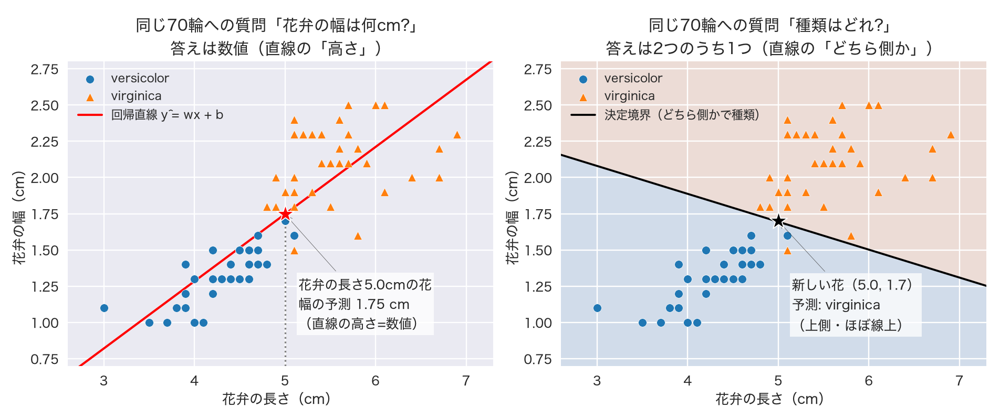

<div class="caption">どちらも同じ学習用70輪（青丸=versicolor、オレンジ三角=virginica）です。左は花弁の長さから幅を予測するので答えは<strong>数値</strong>（赤い直線の高さ）、右は種類を予測するので答えは黒い直線の<strong>どちら側か</strong>で決まります。同じデータでも、問いかけが変われば出力の形が変わります。</div>

<!-- データは左右ともノートブックの学習用70輪で同一。左の回帰は花弁の幅=花弁の長さの一次関数（lesson03と同じ ŷ=wx+b の形、スクリプトで別途計算。長さ5.0cmへの幅の予測1.75cmで、この直線はNotebook本文には無い）。回帰は長さと幅の2列の位置だけを使い、種類ラベルは使わない。右の直線は第5節で学習するフィッシャーの線形判別の境界そのもの（先出し解説はせず、形だけ見せる）。背景の淡い塗りは「その場所で予測される種類」（第5節以降の図と同じ塗り方）。新しい花(5.0, 1.7)はスライド12以降と同じ例で、この花は境界のすぐ側（スライド22で詳しく扱う）。また学習用のversicolor1輪と同一位置なので、図では星がその青い点を隠している（スライド13の距離0.00の同じ花）。左図の実測1.7cmの花と予測1.75cmはほぼ重なっており、回帰の「数値の予測」の読み方の例になる。 -->

---

# 決定境界とは

**決定境界**は、「どちらのクラスと予測するか」を分ける境目です。さっきの図の黒い直線が、まさにその境目です。

- 境界の**どちら側**にいるかで予測が決まる
- 回帰直線は「入力に対する出力の平均的な傾向」。決定境界は「**判断が切り替わる場所**」という意味で、回帰直線とは異なります
- 境界の形はモデルによって違います。今日は**直線**と**折れ曲がった線**の2つを比べます

回帰では出てこなかった概念で、分類の図を読むうえで中心になります。

<!-- 直前の図の黒い直線はフィッシャーの線形判別の境界そのものだが、名前の先出し解説はせず「決定境界」として形だけ示す。折れ曲がった境界はスライド14の図とスライド15で初めて見せる。 -->

---

# 今日のデータとゴール

Iris（アヤメ）のデータから、**versicolorとvirginicaの2種類**だけを使います。

| 項目 | 内容 |
| --- | --- |
| データ | Iris の 2種類 × 50輪 = **100輪** |
| 入力（特徴量） | 花弁の長さ（cm）と花弁の幅（cm）の2つ |
| 予測するもの | 花の種類（versicolor / virginica） |
| 分割 | 学習用 **70輪** / テスト用 **30輪**（種類ごとに学習用35 / テスト用15） |

**今日のゴール:** 散布図で決定境界を見て、k近傍法（kNN）とフィッシャーの線形判別を比べ、テスト用の花で確かめ、ロジスティック回帰の予測確率を読み、混同行列で間違いの内訳を整理します。

---

# 種類の表し方 — 1-of-K coding

講義資料1では、種類をベクトルで表していました。

| 種類 | 表し方 |
| --- | --- |
| versicolor | $[1,\, 0]$ |
| virginica | $[0,\, 1]$ |

所属する種類の要素だけを1に、他を0にします。これを **1-of-K coding** と呼びます。

確率を予測するロジスティック回帰（後半）では、virginicaの確率 $p$ が出れば十分なので、**1つの数値 $p$** として扱います。versicolorの確率は $1-p$ です。

---

# 実習の進め方

ノートブックは**上から順に実行**します。淡い緑のページでノートブックに移り、実行後にスライドへ戻って結果を共有します。

| 実習スライド | Notebookの見出し | 確認すること |
| --- | --- | --- |
| 10 | 3. まず散布図を読む | 2種類の集まりと重なり |
| 18 | 4. k近傍法（kNN） | 近傍5輪の多数決と境界 |
| 25 | 5. フィッシャーの線形判別 / 6. 確かめる | 射影図・直線の境界とテスト正解率 |
| 33 | 7. ロジスティック回帰 | シグモイドの形と予測確率 |
| 40 | 8. 混同行列 | 4マスの内訳と指標、3モデル比較 |

<!-- ページ番号は表紙を1枚目として数える。Notebookの見出し番号はスライド末尾の一覧に対応。 -->

---

<!-- _class: figure -->

# まず散布図を読む

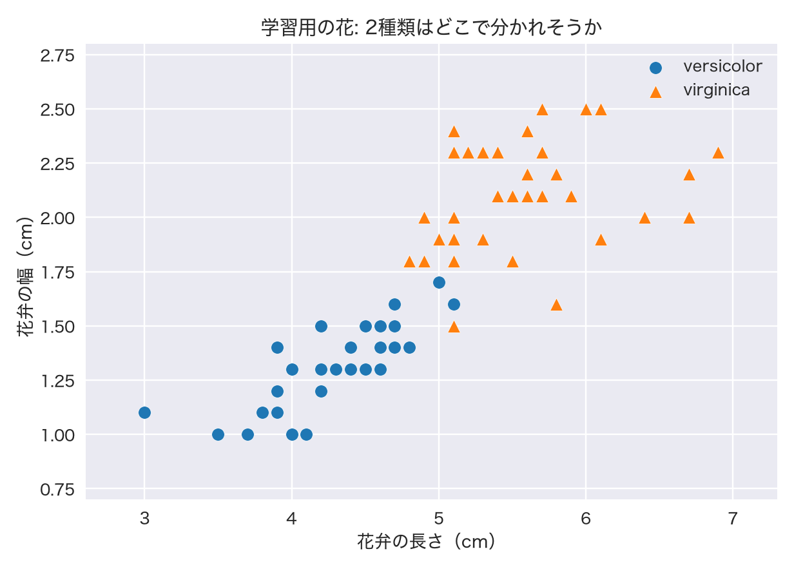

<div class="caption">横軸=花弁の長さ、縦軸=花弁の幅。青い丸がversicolor、オレンジの三角がvirginicaです。</div>

---

# 散布図から読めること

- 右肩上がりの関係：**花弁が長い花は、幅も広い**
- versicolorは**左下寄り**（短くて狭い）、virginicaは**右上寄り**（長くて広い）
- **図の中央付近で、幅が広いversicolorと幅が狭いvirginicaが重なる**

重なりがあるため、**1本の直線で完璧に分けることは期待できません**。どの程度分かれ、どこで混ざるのかが、これからの図の主役です。

<div class="flow">
<div class="box"><strong>分かれ目を見る</strong>決定境界</div>
<div class="arrow">→</div>
<div class="box"><strong>種類を決める</strong>予測</div>
<div class="arrow">→</div>
<div class="box"><strong>間違いを数える</strong>混同行列</div>
</div>

---

<!-- _class: practice -->

# Notebookで実習 ①

**3. まず散布図を読む**（学習用とテスト用の分割も含む）

1. 学習用70輪の散布図を表示する
2. 2種類の集まりの位置と、重なる場所を言葉で説明する
3. `stratify=y` が2種類の比率をどう保っているか確認する

実行したらスライドに戻り、結果を確認します。

---

# 近くの花の多数決で予測する — kNN

見知らぬ花が来たら、**学習用の中で最も近い花の種類を答える**。これがk近傍法（kNN）の発想です。

```python
knn_model = KNeighborsClassifier(n_neighbors=5)
knn_model.fit(X_train, y_train)
knn_model.predict(new_flower)   # → virginica
```

学習は「データをおぼえる」だけで、式を作りません。`predict` のたびに、入力に最も近い**5輪**を探して多数決を取ります。

<!-- k=5。distanceはユークリッド距離、weights='uniform'。 -->

---

<!-- _class: figure -->

# 新しい花に近い5輪を探す

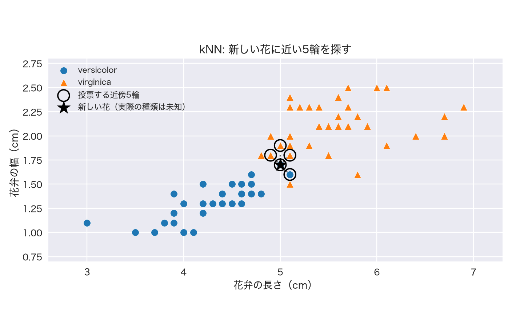

<div class="caption">黒い星が新しい花（花弁の長さ 5.0cm、幅 1.7cm）。黒い輪で囲んだ5輪が投票し、versicolor 2票 / virginica 3票 → virginica と予測しました。</div>

---

# 多数決の中身

| # | 花弁の長さ | 花弁の幅 | 距離 | 種類 |
| --- | --- | --- | --- | --- |
| 1 | 5.0 | 1.7 | 0.00 | versicolor |
| 2 | 5.1 | 1.6 | 0.14 | versicolor |
| 3 | 4.9 | 1.8 | 0.14 | virginica |
| 4 | 5.1 | 1.8 | 0.14 | virginica |
| 5 | 5.0 | 1.9 | 0.20 | virginica |

最も近い1輪はversicolorですが、**5輪の多数決は3対2でvirginica**です。**差は1票**なので、境界付近の花では結果が入れ替わりやすいことが分かります。

<!-- 距離は新しい花(5.0, 1.7)からのユークリッド距離。実行結果の上位5輪を丸めて掲載。学習用に(5.0, 1.7)と同一位置の花が1輪ある。 -->

---

<!-- _class: figure -->

# kNNにも決定境界がある

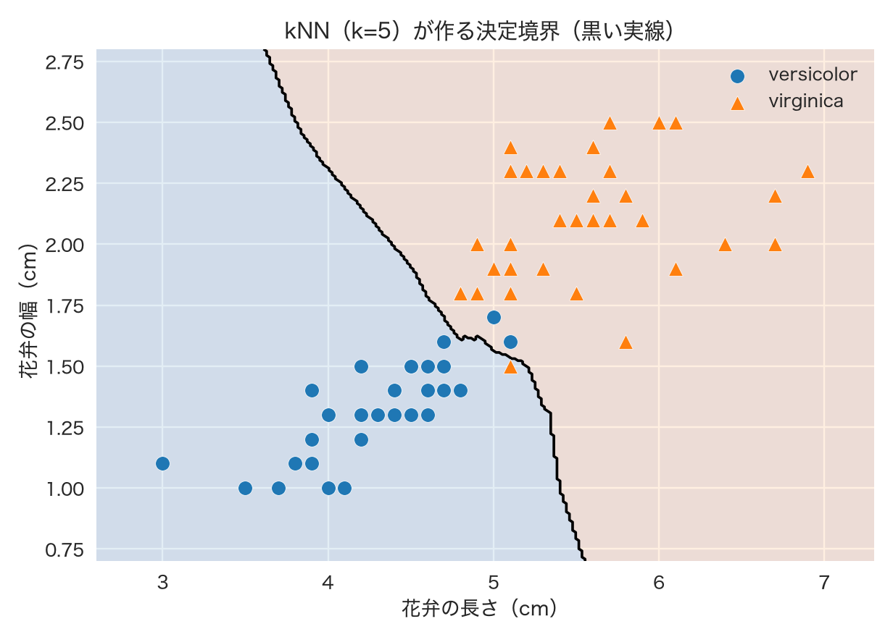

<div class="caption">背景は「その場所で予測される種類」。黒い実線が多数決の切り替わる場所で、折れ曲がった形になります。</div>

---

# kNNの境界は直線ではない

kNNの決定境界は、**1本の直線にはなりません**。

- 境界は近傍5輪の**多数決が変わる場所**。どの5輪が入るかが切り替わるたびに、線が折れ曲がる
- 前の図の黒い実線は、あちこちで**ジグザグに折れ曲がった形**。回帰と分類を比べた図で見たような、まっすぐな線ではありません
- 多数決の差が1票の場所では、花1輪の違いで境界の位置が動きます
- 逆に、境界を**最初から直線に決めて**学習するモデルもあります（第5節のフィッシャーの線形判別）

<!-- 境界の形がモデルで違うことを強調し、次のフィッシャー（直線を仮定するモデル）への動機にする。スライド13の多数決表の「差は1票」と呼応。 -->

---

<!-- _class: figure -->

# kを変えるとどうなるか

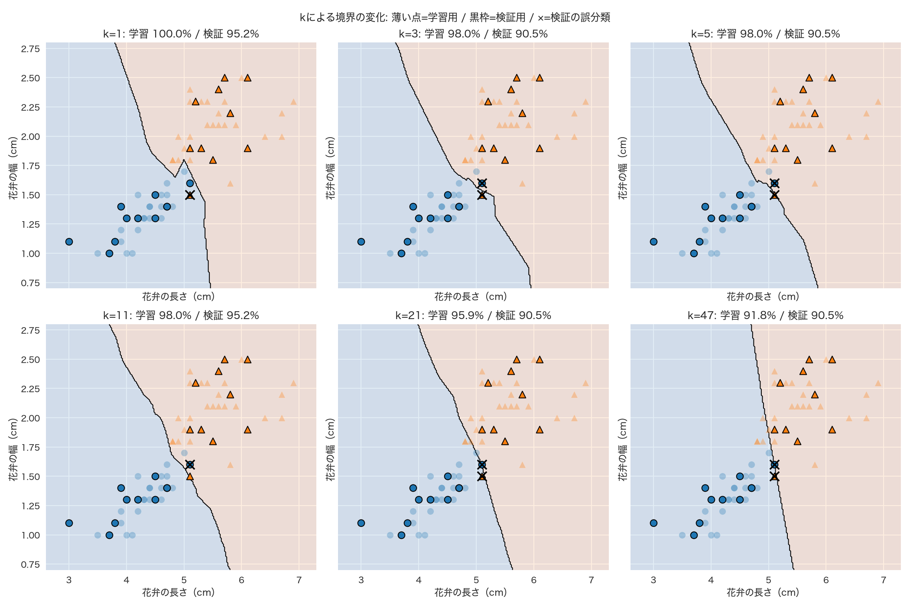

<div class="caption">薄い点=学習用49輪、黒枠=検証用21輪、×=検証用の誤分類。k=1は最も近い1輪のみ、k=47は47輪の多数決です。kが大きいほど境界は単純になり、図の範囲内に境界が現れない場合もあります。</div>

---

<!-- _class: figure -->

# kと正解率

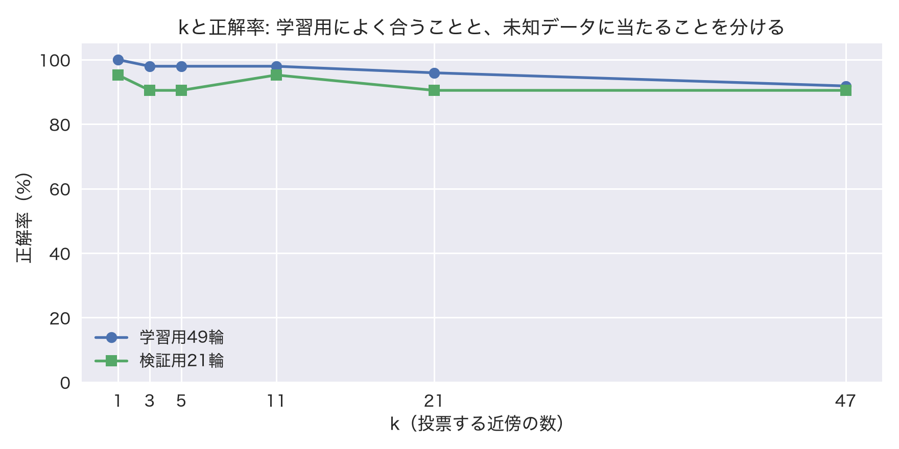

<div class="caption">学習用49輪と検証用21輪の正解率。k=1は学習用では100%で完全に一致しますが、検証用では95.2%でk=11と並び、検証用の最大値です。<br>49/21の分割はkを選ぶために学習用70輪の中から行い、テスト用30輪は使っていません。検証用21輪では1輪が4.8ポイントに対応します。</div>

**学習用によく合うことと、未知データで当たることが同じとは限りません。** この考え方はlesson05のニューラルネットワークで再度中心になります。

---

<!-- _class: practice -->

# Notebookで実習 ②

**4. 近くの花の多数決で予測する — k近傍法（kNN）**

1. 新しい花（5.0cm、1.7cm）に対する5輪の表と多数決を確認する
2. kNNの決定境界の図で、黒い実線の形を見る
3. kを2つ選び、決定境界と学習用・検証用の正解率の違いを説明する

実行したらスライドに戻り、結果を確認します。

---

# 直線の境界を学習する — フィッシャーの線形判別

境界の形を **1本の直線** に決めてしまうのがフィッシャーの線形判別です。

$$y(\mathbf{x}) = w_1 x_1 + w_2 x_2 + w_0$$

| | 意味 |
| --- | --- |
| $y(\mathbf{x}) > 0$ | virginica と予測 |
| $y(\mathbf{x}) < 0$ | versicolor と予測 |
| $y(\mathbf{x}) = 0$ | 境界（ちょうど判断が分かれる直線） |

kNNが「データをおぼえる」のに対し、**2種類の中心と広がりから1組の重み $w$ を学習**します。

<!-- 講義資料1「分類1」の線形識別モデルに対応。 -->

---

<!-- _class: figure -->

# 方向wへ射影する

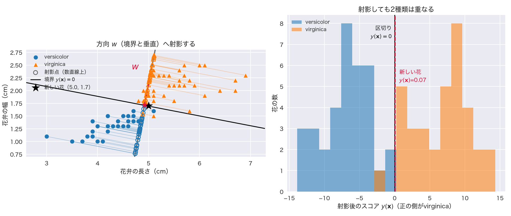

<div class="caption">左：学習用70輪を、境界と垂直な方向 <strong>w</strong>（赤い矢印）の数直線へ正射影します。細い線はそれぞれの花から数直線へ下ろした垂線です。右：射影後のスコア <strong>y(x)</strong> の分布。黒い線が区切り y(x)=0、赤い破線が新しい花（5.0, 1.7）で、スコアはほぼ0＝境界のすぐ側です。</div>

<!-- 数直線上の位置は中心からの距離（cm）。スコア y(x)=w₁x₁+w₂x₂+w₀ は境界からの符号付き距離に比例し、比例定数は |w|≈13.3。数直線は学習用花の全体中心を通る。今回は35対35のバランスなので境界もたまたま中心を通るが、一般には一致しない。右の図の重なりが誤分類の原因で、学習用の誤りは versicolor (5.0, 1.7) スコア+0.07 と virginica (5.1, 1.5) スコア−2.3 の2輪。前者は新しい花と同一位置の学習用花（スライド13と同じ）。新しい花のスコア0.07はスライド22で詳しく扱う。 -->

---

<!-- _class: figure -->

# 同じ花で境界を比べる

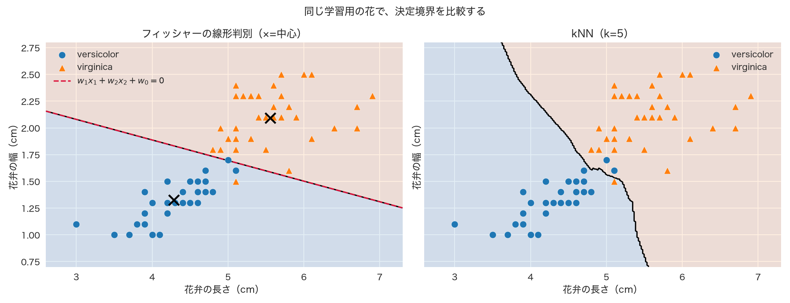

<div class="caption">左=フィッシャー（×は2種類の中心、赤破線は w₁x₁+w₂x₂+w₀=0）、右=kNN（k=5）。境界の形の違いに着目します。</div>

---

# 境界の直線の式

学習で得られた重みは、次の値です。

$$2.52\,x_1 + 13.10\,x_2 - 34.80 = 0$$

新しい花（$x_1 = 5.0$、$x_2 = 1.7$）を代入すると

$$2.52 \times 5.0 + 13.10 \times 1.7 - 34.80 = 0.07 > 0$$

わずかですが正になったので **virginica** です。値が0に近く、この花は境界のすぐ側にいます。kNNと同じ答えでも、**中身は「5輪の多数決」と「直線1本の判定」でまったく違います**。

<!-- 係数と切片は metrics.json の lda.w / lda.w0。 -->

---

<!-- _class: figure -->

# 学習に使わなかった花で確かめる

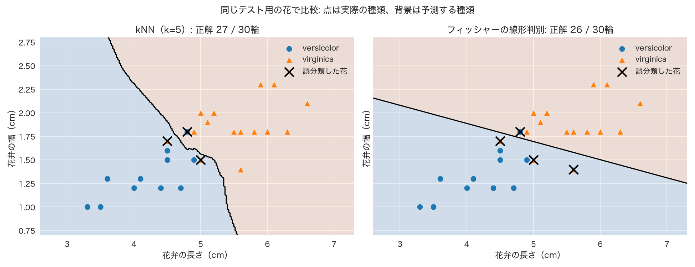

<div class="caption">点は実際の種類、背景は予測する種類。×は誤分類した花です。正解数は、kNNが27/30輪、フィッシャーが26/30輪でした。</div>

---

# 正解率だけで終わらないこと

テスト用30輪の正解率は、kNNが **0.900**、フィッシャーが **0.867** でした。ここから分かることと、分からないこと。

- 分かる：**何輪当たったか**
- 分からない：**versicolorをvirginicaと誤ったのか、その逆か**
- 同じ正解率でも、内訳は変わり得ます

この内訳を表にまとめるのが**混同行列**です（第8節）。まず、予測に**確率**を出すモデルを導入します。

---

<!-- _class: practice -->

# Notebookで実習 ③

**5. 直線の境界を学習する — フィッシャーの線形判別**／**6. 学習に使わなかった花で確かめる**

1. 方向wへの射影図とスコアの分布、境界の直線の式、2種類の中心を確認する
2. 新しい花への2つの予測を比べる
3. テスト用30輪の正解率と、誤分類した花の位置を図と表で確かめる

実行したらスライドに戻り、結果を確認します。

---

# 予測に確率を出す — ロジスティック回帰

名前に「回帰」が入りますが、**分類のモデル**です。予測は「どちらか」ではなく、**virginicaである確率 $p$** です。

$$p = \sigma(w_1 x_1 + w_2 x_2 + w_0), \qquad \sigma(a) = \frac{1}{1+e^{-a}}$$

シグモイドの内側 $w_1 x_1 + w_2 x_2 + w_0$ は、フィッシャーと**まったく同じ形の直線**です。

<!-- 講義資料2「分類2」に対応。 -->

---

<!-- _class: figure -->

# シグモイドσの形

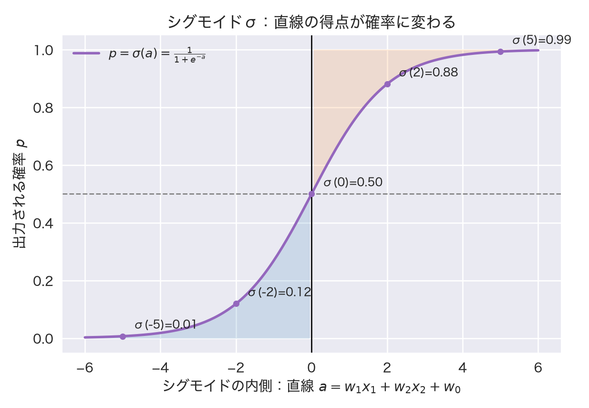

<div class="caption">横軸は内側の直線の得点a、縦軸は確率p。aが0から離れるほど、出力は1または0に近くなります。</div>

---

# シグモイドの読み方

- **$a = 0$ は $p = 0.5$**：仕切りがそのまま決定境界になります
- $a = +2$ で $p = 0.88$、$a = +5$ で $p = 0.99$：**確信度**が読み取れます
- 出力は常に $0 < p < 1$。**境界のどちら側でも確率として比較できます**

「どちらか」だけでなく「**どれだけ確信しているか**」が出るのが、このモデルの利点です。

---

# 重みはどう決まるか

重み $w$ は、**尤度（実際の種類が正しく予測される度合い）を最大にする**最尤推定で決まります。

- 最小化する誤差関数は、回帰の**二乗誤差ではなくクロスエントロピー誤差**
- クロスエントロピーは、正解のクラスの確率を1へ近づけるコスト
- sklearnの既定には**L2正則化**が含まれます。ノートブックではC=100で弱め、講義の導出（クロスエントロピー最小化）に近づけます

<!-- 分類に二乗誤差を使わない理由は、講義資料1の「識別のための最小二乗」の欠点と同じ話。 -->

---

# 学習で得られた重み

```python
logistic_model = LogisticRegression(max_iter=1000, C=100)
logistic_model.fit(X_train, y_train)
print('係数w:', logistic_model.coef_)    # [[5.04, 10.79]]
print('切片w0:', logistic_model.intercept_)  # [-42.69]
```

フィッシャーの $2.52,\ 13.10,\ -34.80$ とは係数も切片も違い、**引かれる直線の向きも異なります**。同じ「1本の直線」でも、引き方は学習の基準（フィッシャー: 2種類の中心と広がり / ロジスティック: 尤度の最大化）で決まります。テスト用30輪の正解率はkNNと同じ0.900でした。

---

<!-- _class: figure -->

# 確率のグラデーションと断面

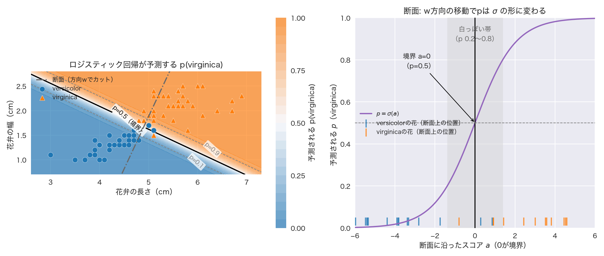

<div class="caption">左：格子の各位置での予測確率 p(virginica)。青とオレンジが濃くなるほど確信が高く、境界の周りは白っぽい帯になります。灰色の一点鎖線は方向w（境界と垂直）で切った断面の線です。右：この線に沿った断面。pは<strong>シグモイドσの形そのまま</strong>に変わり、境界a=0でp=0.5です。下側の目盛りは学習用の花のスコア（境界から±6まで）で、灰色の帯（p 0.2〜0.8）の中にいる花が確率中間の花です。</div>

<!-- 断面の線は学習用花の全体中心を通る、ロジスティック回帰の方向w=(5.04, 10.79)（フィッシャーのw=(2.52, 13.10)とは向きが異なる）。左パネルは縦横比をそろえてあり、断面の線と境界は画面上も垂直。左図の破線は p=0.1/0.9 の目安（|a|=2.20）、右図の灰色帯が p 0.2〜0.8（|a|<1.39、物理幅≈0.23cm）で、右図の横軸は距離ではなくスコア（|w|≈11.9）。目盛りは±6内の29輪のみ表示（41輪は範囲外）。σの急な部分はスライド27、帯に花が集まることはスライド32「確率の図から読むこと」で使う。 -->

---

# 確率の図から読むこと

- 青い花がオレンジ寄りの場所にいる花や、オレンジの花が青寄りの場所にいる花がいます
- 確率が**中間（0.2〜0.8）の花は、この帯に集まります**
- 帯が広いほど「判断に迷う領域」が広いことになり、応用では**棄却**（人間に引き継ぐ）候補です

しきい値を0.5から動かすと、2種類の間違いの件数は入れ替わります。**推論（確率を出す）と決定（線を引く）は別の仕事**です。

---

<!-- _class: practice -->

# Notebookで実習 ④

**7. 予測に確率を出す — ロジスティック回帰**

1. 係数 $w$ と切片 $w_0$ を確認し、境界の向きを予想する
2. テストの花ごとの $p$（virginica）の表を見る
3. 確率の図で、中間確率（0.2〜0.8）の花がどこにいるか探す

実行したらスライドに戻り、結果を確認します。

---

# 間違いを表にまとめる — 混同行列

第8節。テスト用30輪で、フィッシャーの線形判別の予測を数えます（新しいモデルは学習しません）。

<center>

| 実際の種類＼予測 | versicolor | virginica |
| --- | --- | --- |
| **versicolor** | 14 | **1** |
| **virginica** | **3** | 12 |

</center>

- 対角（14と12）: 正解した花
- 右上（1）: versicolorなのにvirginicaと予測（**誤警報**）
- 左下（3）: virginicaなのにversicolorと予測（**見逃し**）

正解率は $(14+12)/30 = 0.867$。**内訳が数字に隠れない表**です。

---

# 4マスの名前 — TP, TN, FP, FN

**positive（陽性として注目する側）をvirginica**にすると、4マスに名前がつきます。

<center>

| 実際の種類＼予測 | versicolor | virginica |
| --- | --- | --- |
| **versicolor** | **TN** 14 | **FP** 1 |
| **virginica** | **FN** 3 | **TP** 12 |

</center>

- **TP**: 実際も予測もvirginica（正しく検出）
- **FP**: versicolorなのにvirginica（false positive）
- **FN**: virginicaなのにversicolor（false negative）
- **TN**: 実際も予測もversicolor

TP・FP・FN・TNは花の性質ではなく、**positiveをどちらに置くかで入れ替わる呼び名**です。

---

# 4マスから様々な指標を計算する

| 指標 | 数式 | 読み方 |
| --- | --- | --- |
| 正解率 | $(TP+TN)\,/\,\text{total}$ | 全体のうち正しく分類できた割合 |
| 誤答率 | $(FP+FN)\,/\,\text{total}$ | 全体のうち誤分類した割合 |
| Precision（適合率） | $TP/(TP+FP)$ | virginicaと**予測した**花のうち、本当にvirginica |
| Recall（再現率） | $TP/(TP+FN)$ | **実際に**virginicaの花のうち、正しく検出 |
| specificity | $TN/(TN+FP)$ | versicolorの花のうち、正しくversicolor |
| false positive率 | $FP/(TN+FP)$ | versicolorのうち、virginicaと誤った割合 |

**Precisionは予測した側でくくる、Recallは実際の種類でくくる**というように、分母の区切り方が異なります。false positive率とspecificityは合計1になります。

---

# 1つの指標だけでは評価できない

テスト用30輪を**全部「virginica」と予測する悪意の分類器**を想像してください。

| | Recall | specificity | 正解率 |
| --- | --- | --- | --- |
| 悪意の分類器 | **1.000** | **0** | 0.500 |
| フィッシャー | 0.800 | 0.933 | 0.867 |

見逃しゼロでRecallは満点ですが、versicolorを正しく分類できた花は1輪もありません。**レポートや論文で指標を1つだけ示すのは危険**で、混同行列をセットで読む必要があります。

---

# 3つのモデルを同じ物差しで比べる

| モデル | 正解率 | TP | FP | FN | TN | Precision | Recall | specificity | FP率 |
| --- | --- | --- | --- | --- | --- | --- | --- | --- | --- |
| kNN（k=5） | 0.900 | 13 | 1 | 2 | 14 | 0.929 | 0.867 | 0.933 | 0.067 |
| フィッシャー | 0.867 | 12 | 1 | 3 | 14 | 0.923 | 0.800 | 0.933 | 0.067 |
| ロジスティック回帰 | 0.900 | 13 | 1 | 2 | 14 | 0.929 | 0.867 | 0.933 | 0.067 |

kNNとロジスティック回帰は**4マスの内訳が完全に同じ**で、フィッシャーだけFNが1輪多い（virginicaの見逃しが1輪多い）と分かります。正解率0.900の2モデルが同じ内訳になったのは、このテスト用30輪での結果です。**正解率はTPとTNの和にすぎないので、正解率から4マスの内訳は復元できません。**

<!-- 値はノートブック実行結果（metrics.json）と同じ。 -->

---

# 予測の確率と、正解との関係

ロジスティック回帰が予測した $p$（virginica）の例です。

| 実際の種類 | $p$（virginica） | 予測（$p\ge0.5$） | 判定 |
| --- | --- | --- | --- |
| versicolor | 0.000 | versicolor | 正解 |
| virginica | 0.656 | virginica | 正解 |
| virginica | 0.993 | virginica | 正解 |
| versicolor | 0.717 | virginica | **誤り** |
| virginica | 0.214 | versicolor | **誤り** |

当たり・外れの判定は $p\ge0.5$ のしきい値で決まり、$p$ の値そのものは**確信の度合い**を示します。中間の $p$ の花が、図の**白っぽい帯**にいます。

---

<!-- _class: practice -->

# Notebookで実習 ⑤

**8. 間違いを表にまとめる — 混同行列**

1. 混同行列の4マスと、正解率が第6節の値と一致することを確認する
2. TP・FP・FN・TNの指標表を計算する
3. 3モデルの比較表で、4マスの内訳の違いを説明する

実行したらスライドに戻り、結果を確認します。

---

# まとめ — 4つの道具

1. **散布図:** 2種類の集まりと重なりを読む
2. **決定境界:** kNNは折れ曲がった境界。フィッシャーは方向wへ射影し $y(\mathbf{x})=0$ で分ける直線の境界
3. **予測確率:** シグモイドが直線の得点を0〜1の確率に変換する。仕切り$a=0$が$p=0.5$の境界
4. **混同行列:** TP・TN・FP・FNから、正解率・Precision・Recall・specificity・false positive率を計算する

正解率は「当たり数」、混同行列は「**間違いの中身**」。分類の評価では両方が必要です。

---

# レポートと今後の接続

レポートでは、ノートブックの「振り返りとレポート」の1〜5をA4 1ページ程度にまとめます。

- 散布図・決定境界の図と、その読み取り
- 2モデルの正解件数・正解率と、誤分類した花の説明
- 混同行列と指標の表。指標から2つ選んで、自分の言葉で説明
- 3モデルの比較表から、4マスの内訳の違いを述べる

しきい値を0.5からどこへ動かすかは決定理論（講義資料2）の話で、3種類以上への拡張はこれからの講義で扱います。lesson05のニューラルネットワークは、今回の「**ニューロン1個のロジスティック回帰**」をいくつも重ねたものになります。
