<!-- _class: cover -->

<!-- _paginate: false -->

# ニューラルネットワークで<br>回帰と分類を解く
## 学習の前・途中・後で、予測はどう変わるか

テーマ5

<!-- 対応資料: ../notebook/lesson05_neural_network_basic_template.ipynb。講義資料1「ニューラルネットワークの歴史と手法1（パーセプトロンまで）」https://www.docswell.com/s/k_fujita/ZPXJ25-2022-05-10-131723、講義資料2「ニューラルネットワークの歴史と手法2（HubelとWieselからLeNetまで）」https://www.docswell.com/s/k_fujita/5RM93Z-2022-06-01-174031 -->

---

# 前回から今回へ — 予測の「つくり方」が変わる

lesson03・lesson04と同じ題材を、**ニューラルネットワーク**で解き直します。問いは同じで、**入力から出力への変換を学習する**ところが違います。

<div class="flow">
<div class="box"><strong>lesson03 回帰</strong>直線 ŷ = wx + b<br>形が決まっている</div>
<div class="arrow">→</div>
<div class="box"><strong>lesson04 分類</strong>多数決・直線・シグモイド<br>判定のルールは固定</div>
<div class="arrow">→</div>
<div class="box"><strong>lesson05 NN</strong>層を重ねて変換し、<br>その重みごと学習</div>
</div>

- lesson03の直線は、**式のかたちを決めて**重みを求めていました
- lesson04のkNNは、**近い順で決める**ルールが固定のままです
- 今回は**入力から出力への変換そのものを学習**します

<!-- lesson04のスライド17で「学習用によく合うことと未知データで当たることが同じとは限らない」と述べた論点は、今回の検証用データ・エポック選びで中心になる。 -->

---

<!-- _class: compact -->

# 講義資料との対応 — 資料の式がコードになる

講義資料1・資料2で出てきた式が、Notebookでは次のコードになります。

| 講義資料の用語・式 | 今回のコード・図 |
| --- | --- |
| 線形閾値素子 $a = \sum_i w_i x_i$ | `nn.Linear`（バイアス $b$ も含む） |
| 活性化関数 $h(a)$（資料2: ReLU） | `nn.ReLU` |
| 多層パーセプトロン（中間層） | 隠れ層 16個 × 2 |
| 誤差関数 $E(w)$（2乗誤差／クロスエントロピー） | `nn.MSELoss` / `nn.CrossEntropyLoss` |
| 勾配降下 $w \leftarrow w - \eta \nabla E(w)$、学習率 $\eta$ | `optimizer`（Adamは改良版）、`lr` |
| 誤差逆伝播法（バックプロパゲーション） | `loss.backward()` |
| batch learning（全データで1回更新） | 1エポック＝学習用全件で1回更新 |

<!-- 資料1はパーセプトロンまで（線形閾値素子・ステップ関数・AND演算・XORの線形分離不可能性）。資料2が多層パーセプトロン・誤差関数・勾配降下・活性化関数・バックプロパゲーション。Adamは資料2の勾配降下の改良版で、勾配の大きさに応じて実際の更新量を自動調整する。資料1の閾値hは PyTorchのバイアスb = −h に対応。 -->

---

# 今日のデータとゴール

lesson03で使ったアイスクリーム、lesson04で使ったIrisを、**同じ物差し**で扱います。

| 題材 | 入力 | 予測するもの | 学習の基準 | 変化を見る図 |
| --- | --- | --- | --- | --- |
| アイスクリーム（回帰） | 月の日最高気温の平均 | 月の平均購入額（円） | MSE | 予測曲線、RMSEの推移 |
| Iris（分類） | 花弁の長さ・幅 | 花の種類（**3種類**） | 交差エントロピー | 決定境界、正解率・損失の推移 |

**今日のゴール:** 学習前・途中・後の予測を見て、**何がどう変わるか**を説明できます。回帰と分類で、ネットワークの**どこが共通でどこが違うか**を説明できます。

<!-- Irisはlesson04の2種類（versicolor / virginica）にsetosaを加えた3クラス。クラス数が増えたことと、データの分け方が違うため、lesson04の正解率0.900などとは単純比較しない。 -->

---

# データを3つに分ける

今回は**学習用・検証用・テスト用**の3つに分けます。役割がはっきり違います。

| データ | 役割 | アイス | Iris |
| --- | --- | --- | --- |
| **学習用** | 重みを更新する | 72か月 | 90輪 |
| **検証用** | 誤差を測り、**使う重みを選ぶ** | 24か月 | 30輪 |
| **テスト用** | **最後に一度だけ**評価する | 24か月 | 30輪 |

- アイスの期間は、学習用2003〜2008年／検証用2009〜2010年／テスト用2011〜2012年です
- **テスト用は、エポックの確認には使いません**。lesson03の学習期間（2003〜2010年）とは違います

<!-- 検証用を重み選びに使う以上、検証用の値は「選んだあとだと楽観的」になる。最終評価は使っていないテスト用でやる、という役割分担。Irisは層化分割（stratify）で各組の種類比率をそろえ、学習用は3種類×30輪、検証・テストは3種類×10輪。 -->

---

<!-- _class: compact -->

# 実習の進め方

ノートブックは**上から順に実行**します。淡い緑のページでノートブックに移り、実行後にスライドへ戻って結果を共有します。

| 実習スライド | Notebookの見出し | 確認すること |
| --- | --- | --- |
| 13 | 1. 共通の準備／2. 回帰 | 3分割の件数と散布図 |
| 26 | 2.4 テスト期間で予測できるか確かめる | 3つの方法のMAE・RMSE |
| 40 | 3.3 テスト用の花を分類する | 正解率と誤分類の位置 |
| 44 | 4. 共通点／振り返りとレポート | 回帰と分類の表の埋め方 |

<!-- ページ番号は表紙を1枚目として数える。PyTorchの導入（%pip install torch）と、notebookディレクトリを作業ディレクトリにすることも実習①で確認する。 -->

---

# Linearがやる計算 — 資料1の線形閾値素子

`nn.Linear` は、入力に重みを掛けて足し、バイアスを足すだけの計算です。

$$a = w_1 x_1 + w_2 x_2 + \cdots + w_D x_D + b$$

- 講義資料1の $a = \sum_i w_i x_i$（**前活性**）と同じもので、$b$ はバイアスです
- `nn.Linear(1, 16)` なら、**16組の $(w, b)$** を持って、16個の $a$ を同時に作ります
- この $w$ と $b$ こそが、**学習で更新される「重み」** です

```python
nn.Linear(1, 16)   # 気温1個 → 16個の a
nn.Linear(16, 16)  # 16個 → 16個の a
nn.Linear(16, 1)   # 16個 → 購入額1個
```

<!-- 資料1の閾値hは f(a−h) という書き方。PyTorchのバイアスbは符号が逆で、a = Σwx + b の b = −h にあたる。名前の細部まではスライドでは触れず「バイアス」とだけ言う。 -->

---

<!-- _class: figure -->

# ReLU — 負を0にする変換

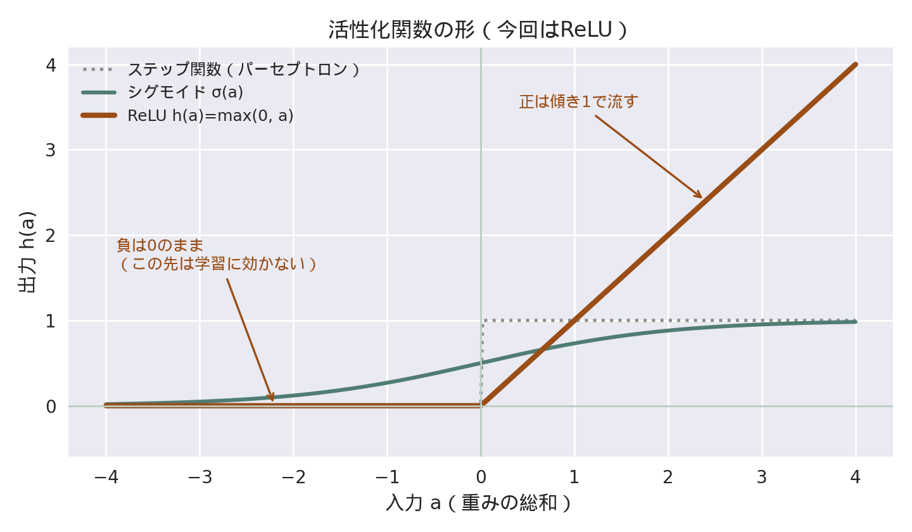

<div class="caption">講義資料2の活性化関数の一覧のうち、今回は<strong>ReLU</strong>を使います。資料1のパーセプトロンがステップ関数（0か1）だったのに対し、ReLUは正の値を大きさそのままに通します。</div>

<!-- 資料2「現在はReLUを使う」: 特別な考えがなければReLU、より深いネットワークを効率的に学習できる、と説明されている。シグモイドはlesson04のロジスティック回帰で既に使っている。 -->

---

# Linearだけでは、まだ直線です

`Linear` を `Linear` の上に重ねても、出力は入力に対してまた**1次関数**です。

$$a_2 = W_2(W_1 x + b_1) + b_2 = (W_2 W_1)\,x + (W_2 b_1 + b_2)$$

- 直線を直線に変換しても、**やはり直線**。lesson03の直線から進めません
- 間に `ReLU` を挟むと、**入力の区間ごとに傾きの違う直線**の組み合わせになります
- 資料2の「多層化するとXORが解ける」は、この**活性化関数があるから**成り立ちます
- 資料2の普遍的な近似器：幅広い活性化関数で、2層のネットワークは任意の精度で関数を近似できる

<!-- 普遍的な近似器は「隠れ層1つ（2層）」の主張。今回は隠れ層を2つ使っているが、近似の話自体は資料2のまま。厳密な条件（有界閉区間・連続関数等）には触れない。 -->

---

<!-- _class: figure -->

# 今日のネットワークの構造

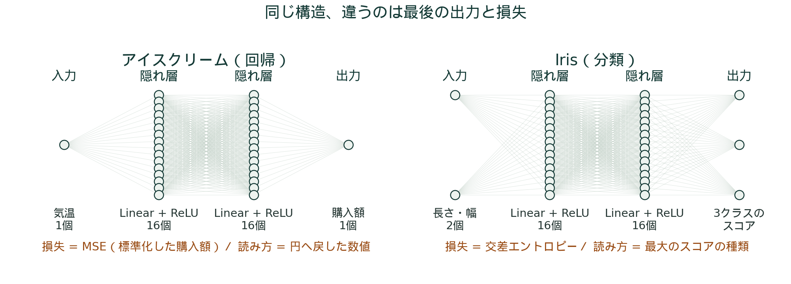

<div class="caption">隠れ層の16個も実際に描いています。回帰と分類で<strong>同じ仕組み</strong>を使い、違いは入力・出力の個数と、学習で小さくする損失だけです。隠れ層の16は内部で計算する数の個数で、入力する特徴量を16個用意する意味ではありません。</div>

<!-- Notebookの nn.Sequential(Linear, ReLU, Linear, ReLU, Linear) に対応。回帰は 1→16→16→1、分類は 2→16→16→3。 -->

---

# 学習の4ステップ — 資料2の勾配降下

毎エポック、次の4つを繰り返すだけです。

```python
prediction = reg_model(reg_X_train)          # 1. 予測する
loss = reg_criterion(prediction, reg_y_train) # 2. 損失を計算する
reg_optimizer.zero_grad()                     # 3. 前回の勾配を消す
loss.backward()                               #    勾配を計算する（誤差逆伝播）
reg_optimizer.step()                          # 4. 重みを更新する
```

- 資料2の $w \leftarrow w - \eta \nabla E(w)$ を、PyTorchが肩代わりしてくれます
- 学習率 $\eta$ が `lr` です。今回は**回帰 0.01、分類 0.02**
- 検証や予測のときは `no_grad()` を使い、**勾配計算しません**（更新しないから）

<!-- `eval()` も予測時のモード指定で、今回のネットワークでは数値に影響しないが習慣として使う。zero_grad() を忘れると勾配が足し合わされる、という説明は発展向け。 -->

---

# エポックとバッチ — 今回は全件で1回

- **エポック**（epoch）は、学習データ全体を使う回数です
- 今回はデータが少ないので、**1エポックで学習用全件をまとめて1回更新**します。資料2でいう **batch learning** です
- **エポック0**は、重みをまだ1度も更新していない状態（ランダムな初期値）です
- 回帰は**600エポック**、分類は**200エポック**学習し、毎エポックの学習用・検証用の値を記録します

<div class="flow">
<div class="box"><strong>エポック0</strong>ランダムな初期値<br>まだ何も学んでいない</div>
<div class="arrow">→</div>
<div class="box"><strong>途中</strong>予測が点に近づく<br>損失が下がる</div>
<div class="arrow">→</div>
<div class="box"><strong>最後・選択</strong>検証用で選んだ重み<br>テストで評価</div>
</div>

<!-- online learning（1件ごと）やmini-batchではない点を明示。資料2の3種類の更新方法の対応確認。 -->

---

<!-- _class: practice -->

# Notebookで実習 ①

**1. 共通の準備**／**2. 回帰: 気温からアイスの平均購入額を予測する**

1. `import torch` が通るか確認する（未導入なら `%pip install torch` を1回実行）
2. 学習72か月・検証24か月・テスト24か月に分かれ、散布図が出ることを確認する
3. 「入力の形: (72, 1) / 正解の形: (72, 1)」の表示を見る

実行したらスライドに戻り、結果を確認します。

---

<!-- _class: figure -->

# アイスのデータ — 気温と平均購入額

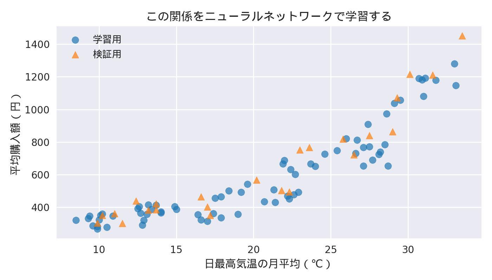

<div class="caption">1行が1か月分です。青い点が学習用（2003〜2008年）、オレンジの三角が検証用（2009〜2010年）。テスト用（2011〜2012年）はここには出していません。</div>

<!-- 入力は「日最高気温の月平均」1つだけ。日平均気温やある1日の気温とは異なる。元教材に地域・集計対象・一次出典の記載はなく、店舗売上や個人の購入額とは断定しない（datasets/README.md）。 -->

---

# 散布図から読めること

- 気温が**低い範囲（約15℃以下の学習用24か月）では、購入額はおおむね270〜420円**（平均349円）で横ばいです
- **約20℃を超えると大きく増え**、25℃超の23か月は平均918円になります
- つまりこの関係は、**1本の直線ではうまく表せません**

lesson03と同じ形の単回帰（今回の学習用72か月に合わせると ŷ = 34.2x − 111.3）は、**5℃上がるたびに171円増える**という一定の増え方しかできません。

今日は、この**曲がった関係そのものを学習**します。

<!-- 直線の傾き34.2円/℃は metrics.json の linear_regression（同じ学習用72か月にフィットした単回帰）。lesson03本文の回帰は学習期間と説明変数が異なるので、数値は引き継がない。 -->

---

# 入力と正解を、学習しやすい大きさにそろえる

気温は数十℃、購入額は数百〜千円。大きさの桁が違うと学習しにくいので、**平均0・標準偏差1**に標準化します。

```python
ice_x_scaler = StandardScaler().fit(ice_train[[ice_feature]])  # 学習用だけから求める
ice_y_scaler = StandardScaler().fit(ice_train[[ice_target]])   # 正解も標準化する
```

- 平均・標準偏差は**学習用だけ**から求め、検証用・テスト用にも**同じ変換**を使います
- 回帰では**正解の購入額も標準化**して学習し、表示するとき `inverse_transform` で円へ戻します
- 図や評価表のRMSEは、**円の単位**のままです

<!-- テスト用の平均・標準偏差を使うと、評価にテストの情報を持ち込むことになり、評価が甘くなる。ここはlesson03からの継続事項。 -->

---

# 回帰のモデルを定義して学習する

```python
reg_model = nn.Sequential(
    nn.Linear(1, 16), nn.ReLU(),
    nn.Linear(16, 16), nn.ReLU(),
    nn.Linear(16, 1),      # 最後の出力が数値1個 → 回帰に使える
)
reg_criterion = nn.MSELoss()
reg_optimizer = torch.optim.Adam(reg_model.parameters(), lr=0.01)
```

- 構造は **気温1個 → 隠れ層16個 → 隠れ層16個 → 購入額1個**
- `MSELoss` は予測と正解の差の2乗の平均（標準化した購入額に対して計算）
- 600エポック学習し、**0・20・100・600エポック**の予測曲線を保存します
- **検証RMSEが最小になった重み**を、テスト用に別に保存します

<!-- torch.manual_seed(42)で初期値を固定。このセルを再実行すると同じ初期状態から学び直す。 -->

---

<!-- _class: figure -->

# 予測曲線が変わっていく様子

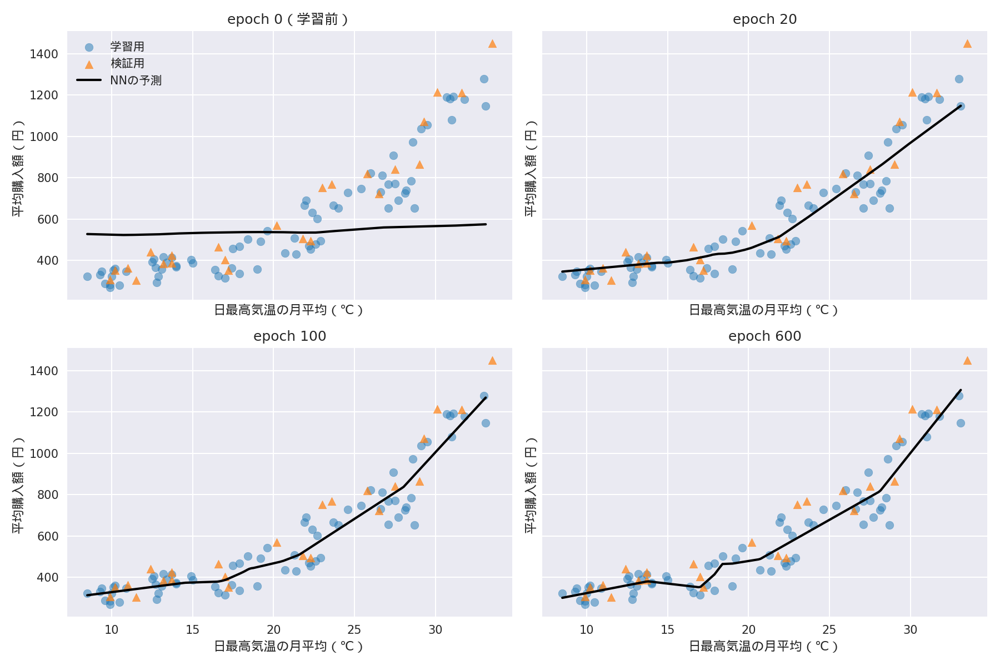

<div class="caption">4枚とも同じ月次データに、各時点の予測曲線（黒）を重ねています。学習前（epoch 0）の曲線はほぼ横ばいですが、学習が進むと低温では緩やか・高温では急な、点の傾向に沿った曲線になります。</div>

---

<!-- _class: figure -->

# 学習曲線 — RMSEの推移

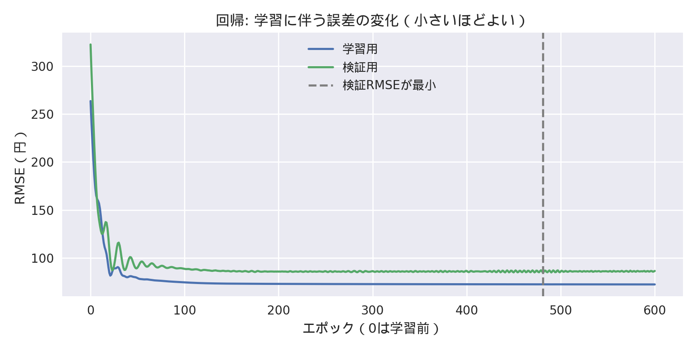

<div class="caption">横軸がエポック（0は学習前）、縦軸がRMSE（円）。青が学習用、緑が検証用です。灰色の破線が、検証RMSEが最小になったエポック（481）を示します。</div>

---

<!-- _class: compact -->

# RMSEの数字で見る — 選ぶのは最後のエポックではない

| エポック | 学習用RMSE（円） | 検証用RMSE（円） |
| --- | --- | --- |
| 0（学習前） | 263.4 | 322.4 |
| 20 | 84.4 | 108.7 |
| 100 | 74.5 | 88.5 |
| 600（最後） | 72.4 | 86.4 |

- **検証RMSEが最小なのは epoch 481 の 84.8円**で、最後の600エポック（86.4円）とは別です
- テストの評価には、**検証用で選んだ epoch 481 の重み**を読み戻して使います
- 学習用は600エポックまで下がり続けますが、検証用は481以降 84.8〜87.0円で横ばいです

<!-- 値は metrics.json の rmse_at_snapshots / best_epoch / best_valid_rmse / valid_rmse_from_best_epoch（481以降 84.8〜87.0円）。急激な悪化ではなく横ばいなので、「過学習で爆発的に悪くなる」例ではない。 -->

---

# 図の読み取り — 傾きと、2つの誤差の差

- **低温と高温で、予測曲線の傾きは同じですか。** epoch 481 の曲線では、10→15℃で約43円、25→30℃で約326円の増加です
- 学習用のRMSEは**263.4円 → 72.4円**へ大きく下がりました。検証用も下がっていますが、**学習用より常に大きい**ままです
- 学習用だけに合わせ込み、未知データで誤差が増える状態を**過学習**と呼びます
- ただし今回は検証誤差が**急激には上昇していない**ので、「過学習が起きている」と断定はしません。**兆候**として読みます

<!-- 43円・326円は metrics.json の curve_prediction_yen（10℃324.8円、15℃368.1円、25℃680.4円、30℃1006.1円）。lesson04スライド17の「学習用によく合うことと未知データで当たることが同じとは限らない」の続き。 -->

---

<!-- _class: figure -->

# 直線と曲線では、表せる関係が違う

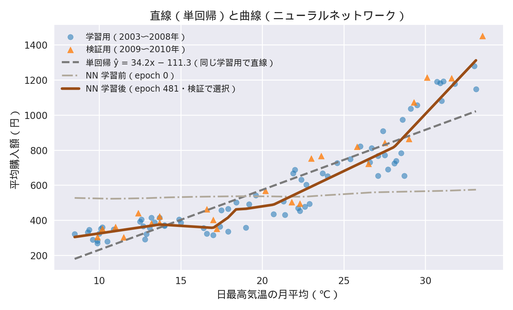

<div class="caption">同じ学習用72か月に、lesson03と同じ形の単回帰（灰色の破線）と学習済みNNの予測曲線（オレンジ、epoch 481）を重ねています。灰色の一点鎖線は学習前です。NNは10→15℃で43円、25→30℃で326円と、増え方が大きく違います。</div>

<!-- この図の単回帰はlesson03本文のモデルではなく、lesson05の学習用72か月に同じ形 ŷ=wx+b でフィットしたもの（スクリプトで別途計算）。NNの曲線はNotebookと同じ実行から得た選択後のモデル。 -->

---

# テスト期間で確かめる

検証用で選んだ重みをそのまま、**2011〜2012年の24か月**で一度だけ評価します。

| モデル | MAE（円） | RMSE（円） |
| --- | --- | --- |
| 学習用の平均（582.1円で予測） | 264.3 | 328.8 |
| 線形回帰（気温のみ） | 119.8 | 151.3 |
| **ニューラルネットワーク（気温のみ）** | **73.2** | **85.6** |

- 日最高気温の月平均が**25℃の月の予測は 680.4円**です
- この条件（気温1つ・同じ学習期間）ではネットワークが最も誤差が小さいですが、**常に優れるとは限りません**

<!-- 値は metrics.json の test / prediction_at_25c。lesson03で扱った「同じ月の平均」や他の気象変数を使う方法も有用な比較対象で、この演習だけでNNが最良とは言えない（Notebook本文と同じ留保）。 -->

---

<!-- _class: figure -->

# テスト期間の予測 — どの月でずれるか

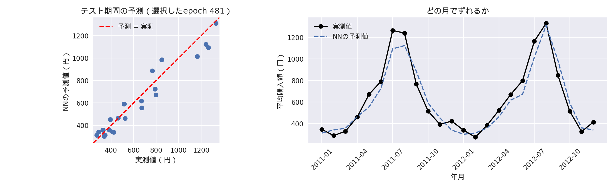

<div class="caption">左: 実測値と予測値を散布図にすると、赤い破線（予測=実測）の上に点があれば過大予測、下にあれば過小予測です。右: 月ごとの実測と予測の推移。2011年7月（実測1,265円・予測1,095円）と2012年7月（実測1,165円・予測1,016円）など、<strong>夏の高い月で予測が実測を下回っています</strong>。</div>

<!-- 24か月のうち14か月で予測<実測（metrics.json の test_months_predicted_below_actual）。2011-07は実測1,265円・予測1,094.9円、2012-07は実測1,165円・予測1,016.0円（test_by_month）。夏に低めに出るのは、学習期間（2003〜2008年）の高温側の値がテスト期間より低かったことと関係する可能性がありますが、スライドでは観察までを述べ、理由は考察に回す。 -->

---

# 回帰でできたことと、限界

**できたこと:** 気温を入力すると、購入額を**数値**で出せました。曲線は直線に限りません。

**限界:**

- 同じくらいの気温でも購入額にはばらつきがあり、**気温だけですべては説明できません**
- 曲線は学習用の点の間に作られるので、**学習に使った気温の範囲外**の予測は当てになりません
- 月の気象値が**分かっている条件**での推定です。月が始まる前の予測なら、気象予報の誤差も足して考える必要があります

<!-- Notebook本文の「できたことと限界」に対応。外挿の注意はスライドでは簡潔に。 -->

---

<!-- _class: practice -->

# Notebookで実習 ②

**2.4 最後に、テスト期間で予測できるか確かめる**

1. 3つのモデルのMAE・RMSEの表を確認し、最も誤差が小さいものと大きいものを言う
2. 25℃での予測額が自分の実行でいくらかを確認する
3. スライド24の図で、予測が実測を大きく下回る月を1つ選び、その気温と購入額を書く

実行したらスライドに戻り、結果を確認します。

---

<!-- _class: figure -->

# 分類へ — Irisを3種類に分ける

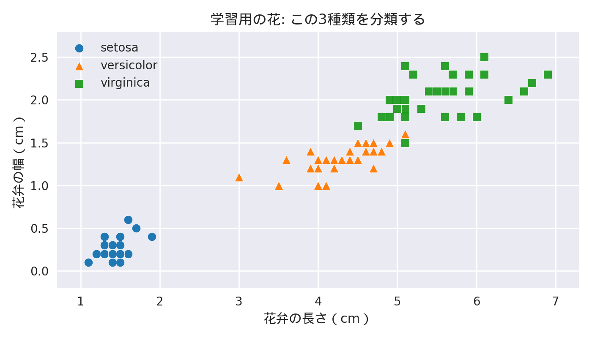

<div class="caption">lesson04と同じ花弁の長さ・幅（cm）ですが、今回はsetosaを加えて<strong>3種類</strong>を分類します。青い丸=setosa、オレンジの三角=versicolor、緑の四角=virginica。学習用90輪（各30輪）の散布図です。</div>

<!-- 種類の数値0,1,2は記号で、大きさの順番ではない。検証用・テスト用は各30輪（各10輪）。 -->

---

# 出力を、3クラス分に変える

回帰と同じ `Linear` と `ReLU` を使い、**最後の出力の数と損失関数だけ**変えます。

```python
cls_model = nn.Sequential(
    nn.Linear(2, 16), nn.ReLU(),
    nn.Linear(16, 16), nn.ReLU(),
    nn.Linear(16, 3),      # 3クラス分のスコア
)
cls_criterion = nn.CrossEntropyLoss()
```

- 出力は**3つのスコア**。スコア自体は**確率ではありません**
- 最大のスコアのクラスを `argmax` で予測します
- `CrossEntropyLoss` は、**正解クラスのスコアが相対的に高くなる**よう学習します

<!-- lesson04で習った1-of-K coding（資料1）のK=3にあたる。スコア→確率の変換は次のスライド。 -->

---

# スコアから確率へ — softmaxと交差エントロピー

3つのスコア $(s_1, s_2, s_3)$ からの確率は、次の式で求めます（**softmax**）。

$$p_k = \frac{e^{s_k}}{e^{s_1} + e^{s_2} + e^{s_3}}$$

- 確率はすべて0より大きく、**3つで1**になります。lesson04のシグモイドの3クラス版です
- 交差エントロピーは「**正解クラスの確率を1へ近づけるコスト**」です（lesson04と同じ）
- `CrossEntropyLoss` は softmax と交差エントロピーを**まとめて計算**する関数です
- 確信が低いときに大きく増えるので、**正解率よりも細かい変化**を見ます

<!-- 資料2の誤差関数は2乗誤差で紹介され、「2乗誤差以外でよく使われるものにクロスエントロピーがある」と注記されている。分類に二乗誤差を使わない理由はlesson04の「識別のための最小二乗」の欠点と同じ話。 -->

---

# 分類の学習 — 200エポック、検証損失で選ぶ

```python
for epoch in range(cls_epochs + 1):        # 0〜200
    if epoch > 0:                          # epoch 0 は更新しない（学習前）
        cls_model.train()
        cls_optimizer.zero_grad()
        loss = cls_criterion(cls_model(cls_X_train), cls_y_train)
        loss.backward()
        cls_optimizer.step()
    # 更新後の同じモデルで、学習用・検証用の損失と正解率を測る
    if valid_loss < cls_best_loss:         # 検証損失が最小なら重みを保存
        cls_best_state = deepcopy(cls_model.state_dict())
```

- **学習率 0.02**、**200エポック**。回帰とは別セルなので、片方だけ実行し直せます
- 背景を塗るため、長さ・幅の**格子点**でも予測を保存します（図用の仮の入力で、観測データではありません）

<!-- lrが回帰0.01に対し分類は0.02。違いを「効き方の強さ」として触れる程度にする。 -->

---

<!-- _class: figure -->

# 識別領域が変わっていく様子

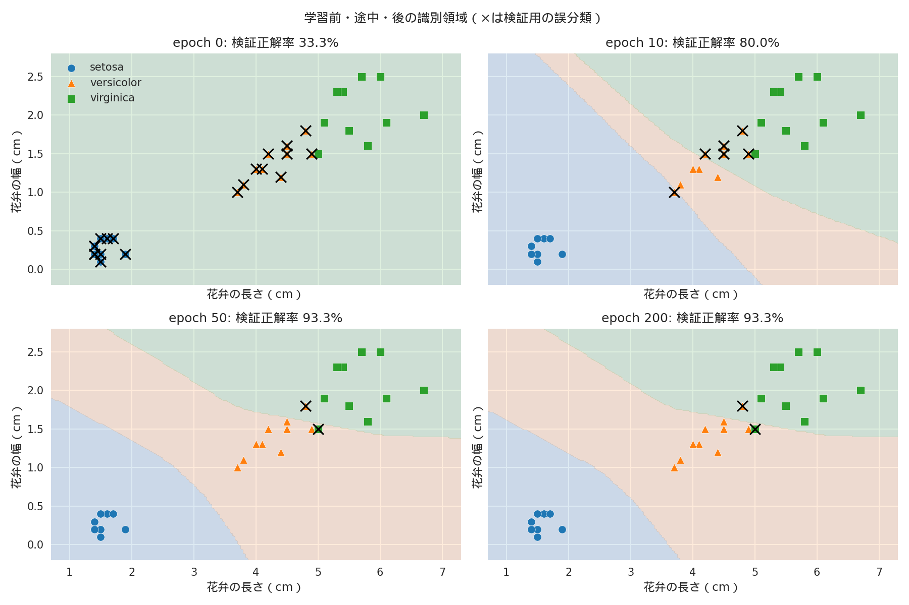

<div class="caption"><strong>背景色が「その場所で予測される種類」、点の色と形が「実際の種類</strong>」です。検証用30輪を重ね、黒い×は誤分類。タイトルは検証用の正解率です。学習前（epoch 0）は全体がvirginicaの1色、学習後は3種類の領域に分かれます。</div>

---

# 学習前（epoch 0）は何をしているか

- epoch 0 の検証正解率は **33.3%**。検証用30輪を**すべてvirginicaと予測**して、10輪だけ当たった値です
- 検証用は3種類が10輪ずつなので、**1種類だけ答え続ける**と正解率は10/30＝約1/3です。ランダムに当てているのではなく、**1クラスしか出していない**状態です
- epoch 10 で80.0%、epoch 50 で93.3%まで上がり、**識別領域の形ができてきます**

<!-- epoch 0の予測は検証用30輪すべてvirginica（metrics.json の valid_predictions_at_epoch0。識別領域のグリッドも100% virginica = grid_class_share_at_snapshots）。33.3%は「3クラスの等確率ランダム」と同じ値だが、意味は「1クラスしか出していない」なので、そこを区別して説明する。 -->

---

<!-- _class: figure -->

# 正解率と損失の推移

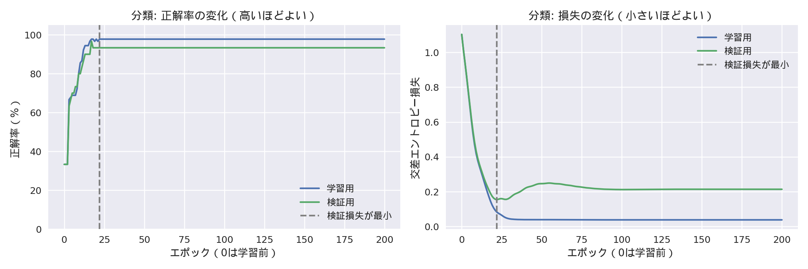

<div class="caption">左が正解率（高いほどよい）、右が交差エントロピー損失（小さいほどよい）。青は学習用、緑は検証用です。灰色の破線が、検証損失が最小になったエポック（22）です。</div>

---

<!-- _class: compact -->

# 数字で見る — 正解率と損失は別のもの

| エポック | 学習用損失 | 検証用損失 | 学習用正解率 | 検証用正解率 |
| --- | --- | --- | --- | --- |
| 0（学習前） | 1.103 | 1.103 | 0.333 | 0.333 |
| 10 | 0.379 | 0.392 | 0.856 | 0.800 |
| 50 | 0.039 | 0.246 | 0.978 | 0.933 |
| 200（最後） | 0.038 | 0.214 | 0.978 | 0.933 |

- **検証損失が最小なのは epoch 22**（0.155）で、最後の200エポック（0.214）とは別です。正解率だけなら **epoch 17の0.967が最大**でした
- **損失で選ぶか正解率で選ぶか**で、選ばれるエポックは変わります。今回は損失で選びました

<!-- 値は metrics.json の at_snapshots / best_epoch / best_valid_loss / valid_accuracy_at_best_epoch / valid_accuracy_max（epoch 17で0.967＝29/30）。 -->

---

# 読み取り — 正解率が頭打ちでも、損失は動く

- 正解率は**クラスが合ったかだけ**を数えます。損失は**正解クラスへの確信の程度**も反映します
- epoch 50以降、検証正解率は0.933で横ばいですが、**検証損失は0.246 → 0.214と動いています**
- 学習用損失は0.038まで下がりますが、検証用損失はepoch 22以降**0.155〜0.250の間**を動き、**学習用との差は埋まりません**
- ただし検証正解率は下がっていないので、「学習が進んでいない」とは言えません。**2つの指標を合わせて読みます**

<!-- 検証損失はepoch 22以降も単調には下がらず、0.155〜0.250の間を動く（metrics.json の valid_loss_from_best_epoch）。正解率だけでは見えない確信度の変化が、次の確率の図につながる。 -->

---

# テスト用の花を分類する

検証損失が最小だった **epoch 22 の重み**を読み戻して、テスト用30輪を評価します。

**テストの正解率 93.3%（28 / 30輪）**

| 花弁の長さ | 花弁の幅 | 実際の種類 | 予測した種類 |
| --- | --- | --- | --- |
| 5.6cm | 1.4cm | virginica | **versicolor** |
| 5.0cm | 1.7cm | versicolor | **virginica** |

- 検証用・テスト用は30輪なので、**1輪の違いで正解率は約3.3ポイント**変わります
- lesson04とは**クラス数もデータの分け方も違う**ため、lesson04の正解率0.900と単純に比べて優劣は付けられません

<!-- 値は metrics.json の test。誤分類2輪は versicolor と virginica の取り違えで、lesson04で見た重なりと同じ場所。 -->

---

<!-- _class: figure -->

# テスト用の花と、誤分類の位置

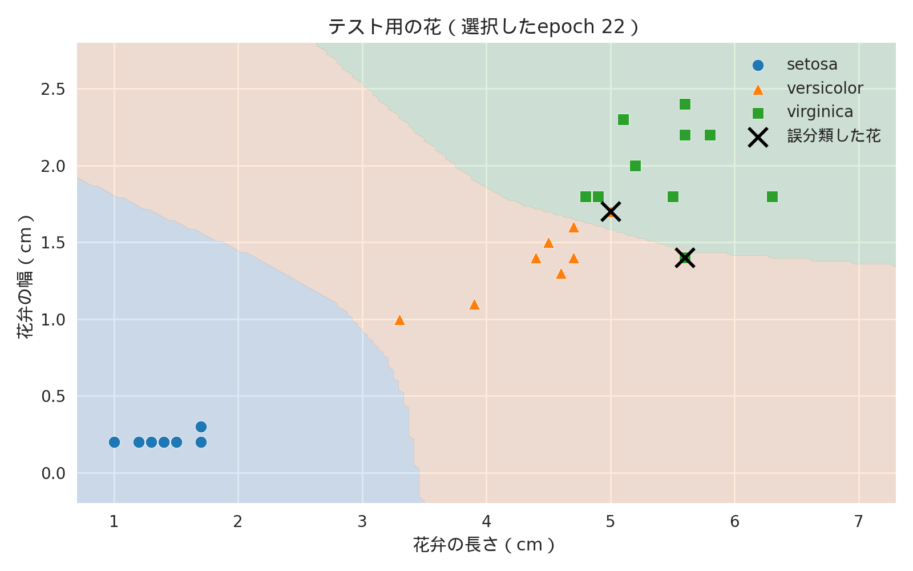

<div class="caption">背景が epoch 22 の識別領域、点が実際の種類、黒い×が誤分類した花です。2輪とも versicolor と virginica の境界付近にあり、setosa（左下）は領域から遠いので誤っていません。</div>

<!-- 誤分類は(5.6,1.4)のvirginicaと(5.0,1.7)のversicolor。setosaは他の2種と離れているため3クラスの中でもっとも確実に分かれている。 -->

---

<!-- _class: figure -->

# 仮の花の予測確率

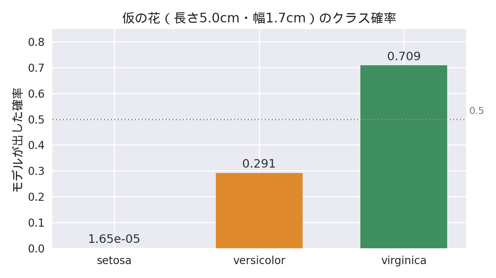

<div class="caption">lesson04でも「新しい花」として扱った位置（花弁の長さ5.0cm・幅1.7cm）の確率です。virginica 0.709、versicolor 0.291、setosa 0.000016 → 最大の<strong>virginica</strong>と予測しました。この位置はテスト用の花（実際の種類はversicolor）とちょうど同じで、スライド37で×をつけた2輪のうちの1輪です。</div>

<!-- 値は metrics.json の new_flower（setosaは1.6e-05で、0ではない点に注意）。same_position_in_test にあるとおり、この座標はテスト用30輪のversicolorと一致し、誤分類になっている。lesson04では2クラス分類の学習用の中に同じ位置のversicolorがあり、フィッシャーのスコア+0.07、ロジスティック回帰のp(virginica)=0.717と「境界のすぐ側」だった花。今回は3クラスで、テスト用の花として現れ、やはり境界付近で迷っている。 -->

---

# 確率は「モデルの推定値」です

- 0.709は「**このモデルがそう信じている度合い**」であって、**必ず正解する保証ではありません**
- 2番目のversicolorも0.29あり、「あり得ない」ほど小さくはありません。**今回は1回学習した結果**なので、条件が変われば順位が変わる可能性もあります
- 確信が低い予測をどう扱うか（人間に引き継ぐ／再測する）は、lesson04で触れた**決定**の話です

<!-- 確率の「校正」の問題には踏み込まない。lesson04のスライド31〜32（確率のグラデーションと棄却）の続き。 -->

---

<!-- _class: practice -->

# Notebookで実習 ③

**3.3 最後に、テスト用の花を分類する**

1. テストの正解率と、正解した輪数／全輪数を確認する
2. 誤分類した花の位置を、識別領域の図上で探す
3. 仮の花（5.0cm・1.7cm）の3つの確率を読み、なぜ迷っているのかを言葉で説明する

実行したらスライドに戻り、結果を確認します。

---

<!-- _class: compact -->

# 何を変えると、回帰にも分類にも使えるのか

| 項目 | アイスの回帰 | Irisの分類 |
| --- | --- | --- |
| 入力 | 気温1個 | 花弁の長さ・幅の2個 |
| 隠れ層 | LinearとReLUで入力を変換 | 同じ仕組み |
| 最後の出力 | 購入額に対応する**数値1個** | **3クラス分のスコア** |
| 学習で小さくする損失 | 標準化した購入額の**MSE** | **交差エントロピー** |
| 結果の読み方 | 円へ戻した予測値、MAE・RMSE | 最大スコアの種類、正解率 |
| 学習率・エポック | lr=0.01、600エポック | lr=0.02、200エポック |

**構造の違いは「最後の出力」と損失だけ**です（学習率とエポック数は別に設定）。これがNNが回帰にも分類にも使える理由です。

<!-- Notebook第4節の表に対応。学習率とエポックの行はNotebookの表にないが、実行条件の差として追加した。 -->

---

# 学習ループも、まったく同じです

回帰でも分類でも、毎エポックやることは**同じ4つ**です。

1. `model(X)` で予測する
2. `criterion(予測, 正解)` で損失を計算する（**ここだけ回帰と分類で違う**）
3. `zero_grad()` で前回の勾配を消し、`backward()` で重みをどう変えるか計算する
4. `step()` で重みを更新する

- 検証・予測中は `no_grad()` を使い、重みの更新に必要な勾配計算をしません
- 検証の値は**重みの更新には使わず、保存するモデルを選ぶためだけ**に使っています

<!--資料2の勾配降下 w ← w − η∇E(w) が step() の中身。Adamは勾配降下の改良版。 -->

---

# 検証用の使い方 — モデルは「選ぶ」もの

- 学習用は**よく合うように**学習するので、学習用の値だけでは未知データでの良さは測れません
- そこで検証用で毎エポック測り、**いちばん良かった時点の重みを選ぶ**（学習を途中で打ち切る**早期停止**と同じ目的ですが、今回は最後まで学習します）
- 回帰は**検証RMSE**、分類は**検証損失**で選び、選んだのはそれぞれ epoch 481 と epoch 22 でした
- **テスト用は選びに使わない**のが決まりです。選び終わったあとで、一度だけ評価します

<!-- 検証用で選んだモデルの検証値は楽観的になるため、最終評価は使っていないデータでやる、という役割分担。発展でエポック数などを変えるときも「テスト結果を見ながら繰り返さない」注意はNotebookにある。 -->

---

<!-- _class: practice -->

# Notebookで実習 ④

**4. 何を変えると、回帰にも分類にも使えるのか**／**振り返りとレポート**

1. スライド41の表と自分の実行結果を突き合わせ、最後の出力と損失の違いを自分の言葉で書く
2. 選択されたエポックと最後のエポックが同じだったか、学習用と検証用の変化が同じだったかを確認する
3. 「エポックを増やせば必ずよくなる」と言えるか、今回の数字を使って考える

実行したらスライドに戻り、結果を共有します。

---

# まとめ — 今日の5つの道具

1. **LinearとReLU:** 重み付きの足し算と、負を0にする変換。これを重ねることで、**直線に限定されない**関係を表せます
2. **学習の4ステップ:** 予測 → 損失 → `backward()` で勾配 → `step()` で更新。資料2の $w \leftarrow w - \eta\nabla E(w)$ です
3. **エポックと学習曲線:** 学習用は下がり続けても、検証用は同じように下がるとは限りません。**過学習の兆候**を読む道具です
4. **検証用で選ぶ:** 回帰は検証RMSE、分類は検証損失で**重みを選ぶ**。テストは最後に一度だけ
5. **出力と損失の切り替え:** 数値1個＋MSEで回帰、K個＋交差エントロピーで分類。**同じ仕組みで両方解けます**

---

# レポートと今後の接続

ノートブックの「振り返りとレポート」を、A4 1〜2ページ程度にまとめます。

1. **回帰でできたこと:** 学習前後の予測曲線とRMSEの推移、テストのMAE・RMSE、25℃の予測額
2. **分類でできたこと:** 学習前後の識別領域と正解率の推移、テストの正解と誤分類
3. **共通点と違い:** 何が共通で、最後の出力と損失をどう変えたか
4. **学習曲線の解釈:** 学習用と検証用の変化、選んだエポックと最後のエポック

<div class="small">発展（任意）: エポック数・隠れ層の大きさ・学習率のうち<strong>1つだけ</strong>変え、検証用の曲線で比較します。テスト結果を見ながらの調整は避けてください。</div>

次回はCNNです。今日の「全部つながった層」を、**画像の局所に限定した層**に置き換えます。

<!-- 発展の実験は、モデル・optimizer・履歴を初期化する学習セルから実行し直し、同じ条件から比較することが条件。テスト結果を見たあとの試行は「学習のための比較」であり、厳密な最終評価には使えない。 -->
